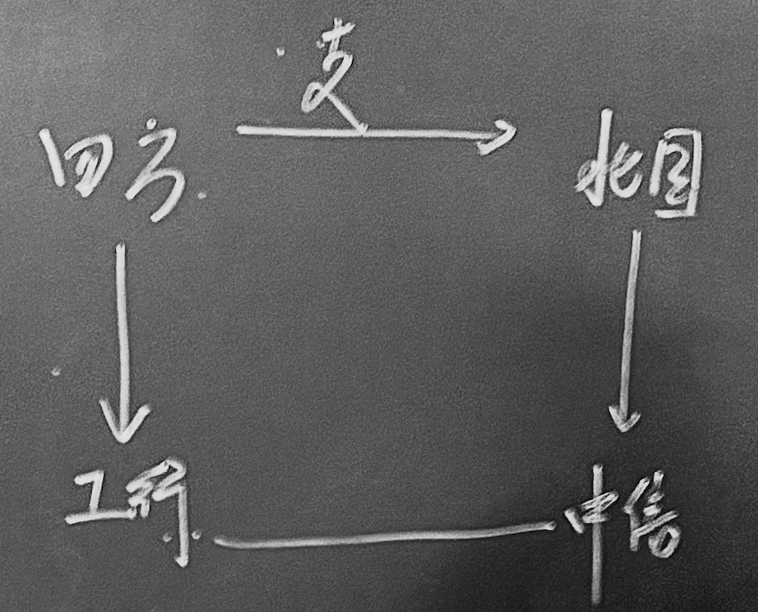

# 现金资产业务

---

### 第一节 现金资产构成和作用

#### 一、构成

指银行持有的**库存现金**以及**与现金等同的可随时用于支付的银行资产**

##### （一）库存现金

保存在金库中的现钞和硬币

- 用来应付客户体现和银行本身的日常零星开支

- 属于**非营利资产**，且保护和保险费用较高

- 持有满足需要的最低额度

##### （二）在中央银行存款

按货币管理当局规定，在中央银行开设的准备金基本帐户上所形成的存款

- 法定准备金 – *按法定比率缴存的存款准备金*
  
  - 具有强制性，一般不得动用
  
  - 定期按照银行存款额的增减进行相应调整
  
  - 是中央银行进行宏观调控的一般性货币政策工具之一

- 超额准备金 – *超出法定存款准备金的那部分存款*
  
  - 是商业银行的**可用资金**，可随时动用
  
  - 可以进行日常支付和贷放活动，如支票清算、电子划拨和其他交易
  
  - 当银行库存现金不足时，也可随时从该部分提取现金

##### （三）存放同业存款

存放在代理行和相关银行的存款

- 属于活期存款，是营运资本的一部分

- 便于银行在同业之间开展业务

##### （四）在途资金

本行通过对方银行向外地付款单位或个人收取的票据

即银行间确认与转账过程中的支票

- 形成原因：*个人、企业或政府部门将其收到的支票存入银行时，不能立即调用该款项，而必须在银行经过一定时间确认后方可体现收用*
  
  > *支票确认流程相当繁琐，详见国际结算、国际贸易等相关课程有讲解，这里不赘述*
  
  

- 时间规定
  
  - 发达国家：约 1～4 天
  
  - 我国：约 7 个工作日
  
  > *持续时间往往很短，因此本章计算头寸时也为将此例外考虑在内*

#### 二、作用

> *库存现金往往不会对银行带来收益，即使有也十分有限*
> 
> - 满足客户交易要求
> 
> - 满足金融当局法定存款准备金要求
> 
> - 满足结算中对现金的需求
> 
> - 满足向其代理行支付现金以换取服务的要求
> 
> 等最低限度要求即可

##### （一）保持清偿力

##### （二）保持流动性

---

### 第二节 资金头寸的计算与预测

#### 一、资金头寸及其构成

*商业银行能够动用的资金*

- 时点头寸 – *时点可用资金*

- 时期头寸 – *时期内可用资金*

##### （一）基础头寸 `库存+超额准备`

*商业银行的**库存现金**与在中央银行的**超额准备金**之和*

##### （二）可用头寸 `!法定准备=基础+同业=支付准备+可贷`

*除法定存款准备金以外的所有现金资产*，包含两方面

> *可以直接理解为商业银行**基础头寸**和**存放同业存款**之和，不考虑在途资金*

- 支付准备金（备付金） – *央行以备付金率规定商业银行必须持有的备付金*
  
  > *我国已取消该比率，将其并入法定存款准备金率*

- 可贷头寸 – *商业银行某一时期可直接用于贷款发放和投资的资金*

#### 二、资金头寸的预测

##### （一）影响因素

*存款变动、贷款变动、购买变现债券、收购发行股票等*

###### 增加因素

*流动性供给*

- 客户存款

- 提供非存款服务所得收入

- 客户偿还贷款

- 银行资产出售

- 货币市场借款

- 发行新股

- 变现债券

###### 减少因素

*流动性需求*

- 客户提取存款

- 合格贷款客户的贷款要求

- 偿还非存款借款

- 提供和销售服务中产生的营业费用和税收

- 向股东派发现金股利

- 收购股份

***主要影响因素依然是存贷的变化***

---

### 第三节 现金资产的管理
