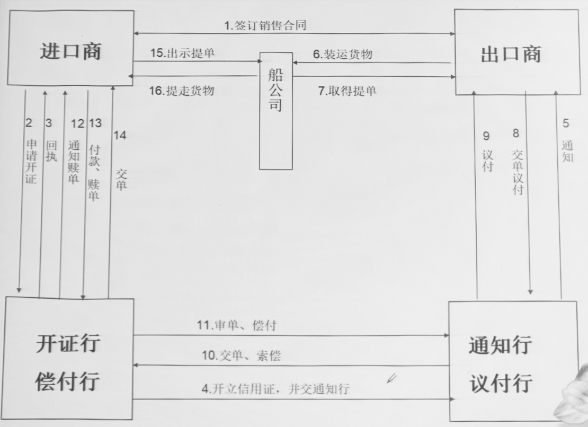

# 信用证结算方式

---

### 第一节 信用证的概念及特点

#### 一、概念

一项不可撤销的安排，无论其名称或描述如何，该项安排构成开证行相符交单予以承付的确定承诺

#### 二、特点

- 是一种银行信用

- 是一种自足文件

- 是一种单据业务

---

### 第二节 内容及开证方式

#### 一、内容

- 本身的说明

- 当事人

- 金额和汇票

- 货物条款

- 运输条款

- 单据条款

- 其他规定

- 等

#### 二、方式

- 信开

- 全电开本 – *速度快、安全可靠、费用高*
  
  - 其中 *SWIFT* 形式最为常见

- 简电开立，附寄证实书 – *银行可能不接受证实书，存在风险*

---

### 第三节 信用证的形式及内容

---

### 第四节 信用证的一般业务程序

