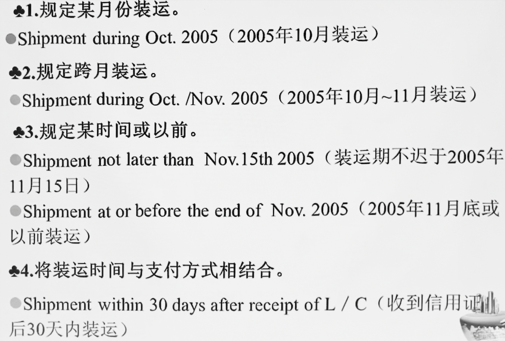

# 国际贸易货物运输

---

### 第一节 海洋运输方式

#### 一、海洋运输方式的特点

##### 优点

- 通过能力强

- 运载量大

- 运费较低

- 对运输货物的适应性强

##### 缺点

- 速度慢

- 深水泊位不足

- 受气候和自然条件的影响较大，风险较大

#### 二、海洋运输的经营方式

##### （一）班轮运输

又称**定期船运输**

###### 1. 特点

- **四固定**：船舶在固定航线上和固定港口之间，按事先公布的船期表和运费率往返

- **一负责**：船方负责配载装卸，装卸费包括在运费中，不计算滞期费和速遣费

- **无合同**：班轮公司和货主双方的权利、义务和责任豁免均已班轮公司签发的提单条款为依据（写在提单背面）

- 承运货物的品种、数量比较灵活，货运质量较有保证，一般在码头仓库交接货物

###### 2. 计收依据与计收标准

**(1) 计收依据** – *班轮运价表，分为*

- 货物分级表
  
  - 一般 1～20 级，不同级别费率不同

- 各航线费用表

- 附加费用表

- 冷藏货及活牲畜费率表

**(2) 计收标准** – *分为两部分*

- 基本运费 – *其计收标准分为八种*
  
  - 按货物毛重
    
    - 又称**重量吨（*Weight Ton*）**，运价表中用 **W** 表示
    
    - *1 W = 1 M/T*
  
  - 按体积/容积
    
    - 又称**尺码吨（*Measurement Ton*）**，运价表中用 **M** 表示
    
    - *1 M = 1M^3*
  
  > 前两者统称**运费吨**
  
  - 按毛重或体积计收
    
    - 选择毛重或体积中收费较高的作为计费吨，运价表中用 **W/M** 表示
    
    - $积载系数=\frac{货物的毛重}{货物的体积}$
    
    - 积载系数 > 1：重货，按重量计征
    
    - 积载系数 < 1：轻货，按体积计征
  
  - 按商品价格计收
    
    - 又称**从价计费**，运价表中用 **AV** 或 **Ad Val** 表示
    
    - 按货物 FOB 价格的 0.X%～2% 收取，适用于贵重物品
  
  - 在重量、尺码、价值三者中选最高的一种计收 – **W/M or Ad Val**
  
  - 重量、尺码选较高的，再加上葱加运费计收 – **W/M plus Ad Val**
  
  - 每件货物作为一个计价单位计费
  
  - 协商计费

- 附加费 – *对于一些需要特殊处理的货物，或者由于突然事件的发生等原因而额外加收，无记收标准*

###### 3. 附加费

*一般均为百分比形式*

- 超重附加费

- 超长附加费

- 选港附加费

- 直航附加费

- 转船附加费

- 港口附加费

- 燃油附加费

- 绕航附加费

- 洗舱费，等

###### 4. 计算方法

1. 选择相关运价表

2. 查询计费标准和运价等级

3. 查航线

4. 查附加费

5. 代入班轮运费计算公式

$$
班轮运费=基本运费+附加费
$$

$$
班轮运费=基本费率\times运费吨\times(1+附加费百分比)
$$

> ##### 班轮运费例题
> 
> ###### 例一
> 
> 商品总重 10M/T，400箱，每箱毛重 25kg，体积 20cm×30cm×40cm，单价 CFR 马赛，每箱 55$
> 
> 该货物为 8 级，计费标准 W/M，每运费吨运费 80$，令征收港口附加费 20%，燃油附加费 10%，计算运费
> 
> > 25×400 = 10000 kg = 10 M/T，10×80 = 800
> > 
> > 0.2×0.3×0.4×400 = 9.6 m^3，9.6×80 = 768
> > 
> > 800 > 768，取前者
> > 
> > 运费 = 800×(1+20%+10%)= 1040 $
> 
> ###### 例二
> 
> 100 箱，每箱 4000\$ FOB 上海，基本费率为每运费吨 26\$ 或从价费率 1.5%，以 W/M or Ad Val 选择法计算，体积 1.4m×1.3m×1.1m，毛重每箱 2M/T
> 
> 加收燃油附加费 10%，港口附加费 20%，直航附加费 40%，计算运费
> 
> > 26×100×2 = 5200 M/T
> > 
> > 26×1.4×1.3×1.1×100 = 5205.2 m^3
> > 
> > 4000×100×1.5% = 6000 $
> > 
> > 运费 = 6000×(1+10%+20%+40%) = 10200 $
> 
> ###### 例三
> 
> CFR 利物浦每箱 35$，英国商人要求改报 FOB 价格
> 
> 体积 45×40×25 (cm)，每箱毛重 35 kg，计费标准 W/M，基本运费 120 美元/运费吨
> 
> 加收燃油附加费 20%，绕航附加费 10%，我方应如何报价？
> 
> > 120×0.035 = 4.2 $
> > 
> > 120×0.45×0.4×0.25 = 5.4 $
> > 
> > 每箱运费 F = 5.4×(1+20%+10%) = 7.02 $
> > 
> > > ***CFR - F = FOB***
> > 
> > $P_{FOB}=P_{CFR}-F=35-7.02=27.98$ \$
> 
> > 或
> > 
> > 积载系数 = $\frac{35}{0.45\times0.4\times0.25}$ = 0.78，判断为体积计征
> > 
> > F = 120×0.045×(1+20%+10%) = 7.02 $
> > 
> > $P_{FOB}=P_{CFR}-F=35-7.02=27.98$ \$
> > 
> > *答：改报价为 USD27.98 per case FOB Shanghai*

##### （二）租船运输

又称**不定期船运输**

*四不定、有合同*，即一切按照租船合同约定安排

###### 1. 方式

- 定期租船 – *按期限租赁*
  
  - 一般只规定航行区域
  
  - 承租人负责营运调度、燃料、港口等费用
  
  - 不规定装卸率和滞期、速遣费条款
    
    - 装卸率：装货完毕的规定期限
    
    - 滞期率：未能期限内装货完毕的额外**罚金**
    
    - 速遣费：期限内装货完毕的**奖金**
  
  - 订明货物装卸费由谁负担
  
  - 船舶的维持费用、船员的工资给养由船东负责
  
  - 租金，即运费按货物的数量以及双方商定的费率计算

- 定程租船
  
  - 规定航线、装卸港口、航行船期
  
  - 船方按合同规定完成货物运输任务，负责运营管理及航行中各项费用
  
  - 需规定装卸率和滞期、速遣费条款
  
  - 订明货物装卸由谁负责
  
  - 船舶、船员和定期租船一致
  
  > 船舶的营运和调度权限不同
  > 
  > 租金，即运费计算方法不同
  > 
  > 合同规定的条款不同

- 光船租船 – *又称船壳租船，属于财产租赁*

- 包运租船 – *又称运量合同，类似反复多次的定程租船*

###### 2. 主要条款

- 运费与装卸费
  
  - 船方负责 – *Gross/Berth Terms/Liner Terms*
  
  - 船方不负责 – *FIO, Free In and Out*
  
  - 船方管装不管卸 – *FO, Free Out*
  
  - 船方管卸不管装 – *FI, Free In*

- 许可装卸时间
  
  - 按日或连续日 – *直接零时开始的连续时间*
  
  - 晴天工作日 – *扣除非工作日及因天气原因不能进行装卸工作的时间*
  
  - 工作日 – *扣除非工作日*

---

### 第二节 海洋运输单据

#### 一、海运提单的概念和性质

##### （一）概念

船长或承运人的代理人签发的证明海上运输合同和货物由承运人接管或装船以及承运人据以保证交付货物的单据

##### （二）性质

###### 1. 货物收据

###### 2. 物权凭证

- 可以向承运人提取货物

- 可以向银行议付货款或抵押货款

- 可以通过转让提单的方法转让货物的所有权

###### 3. 运输契约的证明

- 是承运人与托运人之间订立的运输契约的证明

- 明确规定了承运人和托运人之间的权利、责任与豁免，是处理承运人与托运人间的争议的法律依据

#### 二、海运提单的基本内容

- 正面记载事项

- 背面印就条款

#### 三、海运提单的分类

##### （一）按货物是否已装船

- 已装船提单

- 备运提单 – *承运人已收到装运货物，等待装运时签发*
  
  - 可在装船后凭以调换已装船提单
  
  - 或在装船后经承运人或其代理人在备运提单上批注货物已装上某船及装船日期，并签署后变为已装船提单

> *国际贸易中，一般都要求卖方提供已装船提单*

##### （二）按货物外表状况有无不良批注

- 清洁提单
  
  **表面状况良好**，承运人在提单上不带有明确宣称货物及/或包装有缺陷批注

- 不清洁提单
  
  > ###### 下列批注不认作不清洁提单
  > 
  > - 不明确表示货物或包装不能令人满意 – *旧箱、二手麻袋包装等*
  > 
  > - 强调承运人对于货物或包装性质所引起的风险不负责
  > 
  > - 承认承运人知道货物的内容、重量、容量、质量或技术规格的批注

> *银行为安全起见，在议付货款时均要求提供清洁提单*

#### 四、记名、不记名和指示提单

根据提单上收货人一栏的不同写法分类

- 记名提单 – *明确收货人*
  
  - 适用用于展览品或贵重物品
  
  - 较为少见

- 不记名提单 – *不明确收货人，即不填写任何人*
  
  - 风险较大
  
  - 较为少见

- 指示提单 – *填上“凭（某人）指示“*
  
  - 可凭背书进行转让
  
  - 利于资金周转，较为普遍
  
  - 有空白背书和记名背书两种

#### 五、直达提单、转船提单和联运提单

#### 六、全式提单和简式提单

#### 七、班轮提单和租船提单

#### 八、运费预付提单和运费到付提单

#### 九、其他种类的提单

- 舱面提单 – *又称甲板提单，货装甲板*
  
  > 一般投保舱面限，以保证货物的运输安全

- 倒签提单 – *实际装运日期迟于信用证或规定日期时，将提单上装运期提前以符合要求*

- 预借提单 – *装船期已到，货物尚未装船就要承运人预先签发提单并借给托运人*

> 后两者具有非法和欺诈性质，应禁止使用
> 
> ~~对方不追究万事大吉，一旦追究上诉必败无疑~~

- 过期提单
  
  - 错过交单日期 – *提单签发日期后 21 天才交到银行议付的提单*
  
  - 晚于货物到达目的港的日期

- 正本提单 – *原件*

- 副本提单 – *复印件*

---

### 第三节 集装箱运输方式

##### 装箱方式

- 整箱货（*Full Container Load, FCL*）

- 拼箱货（*Less than Container Load, LCL*）

##### 交接方式

- 门到门（*Door to Door, DD*）

- 集装箱堆场（*Container Yard, CY*）

- 集装箱货运站（*Container Freight Station, CFS*）

---

### 第四节 其他运输方式

*略*

---

### 第五节 合同中的装运条款

#### 一、装运时间

##### （一）规定装运期的方法

##### （二）规定装运时间应注意的问题

- 考虑货物的性质以及交货的季节性
  
  - 雨季不宜装运烟叶
  
  - 夏季不宜装运沥青、易腐肉类、橡胶等

- 考虑货源、运输和市场需求等实际情况

- 对装运时间的规定要明确，装运期限应当适度，**不能规定限于某日装运**

- 考虑开证日期的规定是否明确合理
  
  - *争取信用证有效期长于装运期 15 天*

- 结合考虑交货港、目的港的特殊季节因素

#### 二、装运港（地）和目的港（地）

##### 注意事项

- 一般均分别规定为一个

- 可选择港写作如下形式
  
  - `CIF London, optional Hambung / Rotterdam`
  
  - `CIF London / Hambung / Rotterdam`

- 注意规定买方最后宣布目的港的时间

- 注意国外港口有无重名问题
  
  - 在港口后加上国名或地区名

#### 三、分批装运和转船

##### （一）分批装运

*Partial Shipment*

合同中约定即可

- *allowed / permitted* 准许

- *not allowed / not permitted / prohibited* 不准

##### （二）转运或转船

- *without transshipment* 不允许转运

- *transshipment at XXX is allowed* 允许在某地转船

> ###### 《UCP 600》
> 
> - 默认允许分批支款/装运
> 
> - 运输单据表面注明同一运输工具、同一航次、同一目的地的多次装运，即使表面上注明不同的装运日期/不同装货港/地点，也不视为分批装运
>   
>   - *实际客观装运方式以运输单据为准*
>   
>   - 如，同一航次同一船只，不同两地装运，即使提单注明的是不同日期和港口，也不算作分批装运（说人话就是一定要至少两趟才算）
> 
> - 如果信用证规定在指定时期内分期装运及/或支款，而其中任意期未按期装运及/或支款，除非信用证另有规定，否则信用证对该期及以后各期均失效
