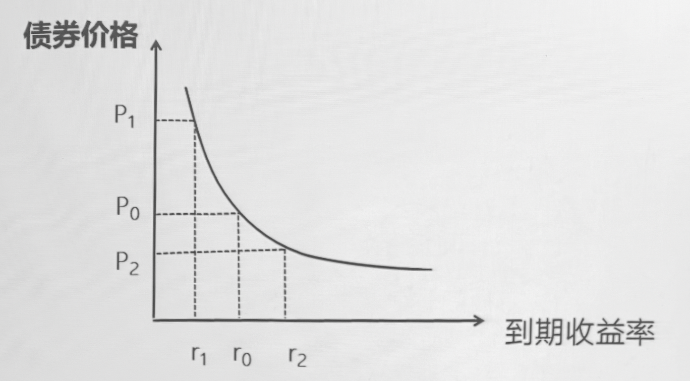
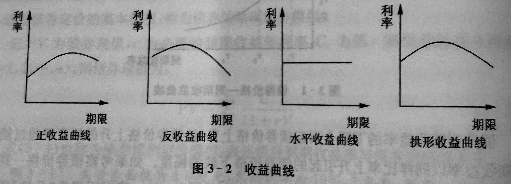

# 证券估值

---

### 第一节 债券及债券估值

#### 一、债券的特征及分类

> *债券是按照法定程序发行，规定在一定期限内**还本付息**的有价证券。*
> 
> 债券的**本金**、**到期期限**和**利息或者利率**，是其最基本的三个要素。
> 
> 债券的本质是一种债务凭证或合同，反映筹资者和投资者之间的债务债权关系。
> 
> 债券的估值，即是把其所代表的未来现金流往期初折现的过程。

##### （一）特征

- 一般在发行时即**确定偿还期限**

- 普通债券的**利率固定**（*利息税前列支*）

- 债券有比较好的**流动性**
  
  - 可以在没有损失/损失很小的情况下变现
  
  - 一般情况下，证券市场越发达，其流动性越强

- 独有的特殊条款
  
  - **限制性条款**：债权人在没有公司股东投票权的前提下，可以要求对发行债券公司的重大投资决策有一定的发言权
    
    > *主要表现为债务合同中常常包括限制经营者和股东职责的条款*
  
  - **选择性条款**：在债务合同中，发债公司和债权人具有某些选择权
    
    > *发债公司的可赎回条款、债权人的可转换条款等*
    > 
    > - 赎回债券
    > 
    > - 转换股票

##### （二）分类

###### 1. 按发行机构主体

- 政府债券
  
  - 国家债券（国债）
  
  - 地方政府债券（化债）
  
  - 政府机构债券

- 金融债券 – *银行或非银行金融机构发行*

- 公司债券（企业债券）
  
  - 无抵押公司债券 – *完全凭发债公司信用发行，无需提供任何抵押品*
  
  - 抵押公司债券 – *以发债公司动产或不动产作为抵押发行*
  
  - 流动抵押公司债 – *以发债公司所持有的动产或有价证券作为抵押发行*
    
    > 这些抵押品需要保管在受托人手中，以信托方式担保运行，因此又叫**担保信托债券**
  
  - 分红公司债券 – *得到利息收入的同时，在发债公司存在超额盈余时可以得到分红*
    
    - 像股票，但本质仍然属于浮动利率债券，持有人对公司没有任何控制权
    
    - 一般在公司处于困难状况，难以以正常渠道筹集资金时发行，利率往往较低 – *股东让渡利益来筹集资金*
  
  - 可赎回债券 – *对应可赎回条款*
  
  - 可转换债券 – *对应可转换条款*
  
  - 附认股权证债券 – *附加认股权证，当债券公司发行股票时，持券人有以优先价格认证股票的权益*

###### 2. 按计息方式

- 单利债券 – *利率固定*

- 复利债券 – *利滚利*

- 附息债券 – *又叫定息债券，间隔固定期限支付固定利息，到期后返还本金*

- 贴现债券 – *又叫贴水债券/贴息债券，本身不存在利息收入，投资者利益来源于此类债券以低于面值的价格发行，到期后返还面值*

- 零息债券 – *和贴现债券类似，不存在利息收入，以低于面值价格发行到期后返还面值*
  
  - 和贴现债券的根本区别是**贴现债券期限往往不超过一年，零息债券总在一年以上**

- 浮息债券 – *利率随市场状况波动*

###### 3. 按是否记名

- 记名债券 – *背面标注持有人姓名，并登记于发行公司名册*
  
  - 安全，但流通性很差（需要背书转让，手续繁琐）

- 不记名债券 – *和前者相对应*

###### 4. 按发行地点

- 国内债券 – *本国发行、本国货币作为面值*

- 国际债券 – *国外市场发行、外国货币作为面值*
  
  - 外国债券 – *发行方在外国市场发行，以该国货币作为面值计价*
    
    - 外国在中国发行以人民币为面值计价的债券 – *熊猫债券*
    
    - 美国的*扬基债券*、日本的*武士债券*等
  
  - 欧洲债券 – *国外市场发行、第三国货币作为面值*

###### 5. 按发行方式

- 公募债券

- 私募债券

#### 二、债券的估值

##### （一）影响因素

- 债券期限

- 票面利率（息票率）
  
  *票面利率高 -> 利息提高 -> 现金流入提高 -> 债券价值提高*

- 市场利率
  
  *市场利率高 -> 要求的到期收益率高 -> 折现率提高 -> 现值额减少 -> 债券价值提高*

> *当息票率 > 市场利率，债券价值随债券期限增加而增加*
> 
> *当息票率 < 市场利率，债券价值随债券期限增加而减少*

- 其他条款—提前赎回条款

- 利息收入是否纳税

##### （二）估值模型

*债券价值取决于持有债券而获得的未来现金流量的现值*

即将未来现金流量用合理折现率折算成现值，相加得到的总收入即为债券的内在价值

$$
PV=\sum_{t=1}^n{\frac{C_t}{(1+r)^t}}
$$

> ###### 样例
> 
> - 面值 1000，票面利率 10%，三年到期一次还本付息，折现率 12%
>   
>   $$
>   PV=\frac{1000\times(1+10\%)^3}{(1+12\%)^3}
>   $$
> 
> - 面值 1000，期限 3 年，折现率 12%
>   
>   $$
>   PV=\frac{1000}{(1+12\%)^3}
>   $$
> 
> - 面值 1000，三年期，每半年付息一次，年息票利率 10%，市场利率 12%
>   
>   $$
>   PV_1=\frac{1000\times\frac{10\%}{2}}{1+6\%}
>   $$
>   
>   $$
>   PV=\sum_{i=1}^5\frac{1000\times\frac{10\%}{2}}{(1+6\%)^i}+\frac{1050}{(1+6\%)^3}
>   $$

> ###### 研究
> 
> *面值 1000，3 年期，每半年付息一次，年息票利率为 6%，市场利率 10%，按复利贴现*
> 
> `(P/F,10%,3)=0.7513;(P/A,10%,3)=2.487;(P/F,5%,6)=0.7462;(P/A,5%,6)=5.076`
> 
> - *理论价值？*
>   
>   每半年利息收入 $C_1=1000\times\frac{6\%}{2}=30$
>   
>   $PV_1=30\times(P/A,\frac{10\%}{2},6)+1000\times(P/F,\frac{10\%}{2},6)=898.48$
> 
> - *如果年息票利率 14% 的理论价值？*
>   
>   每半年利息收入 $C_2=1000\times\frac{14\%}{2}=70$
>   
>   $PV_2=70\times(P/A,\frac{10\%}{2},6)+1000\times(P/F,\frac{10\%}{2},6)=1101.52$
> 
> - *如果年息票利率 10% 的理论价值？*
>   
>   每半年利息收入 $C_3=1000\times\frac{10\%}{2}=50$
>   
>   $PV_3=50\times(P/A,\frac{10\%}{2},6)+1000\times(P/F,\frac{10\%}{2},6)=1000$
> 
> ###### 规律总结
> 
> - 息票利率 = 市场利率：理论价值 = 面值
> 
> - 息票利率 > 市场利率：理论价值 > 面值
> 
> - 息票利率 < 市场利率：理论价值 < 面值

##### （三）债券价格的性质

使得债券市场价格和债券的内在价值相同的市场利率为**到期收益率**

- 债券的市场价格与到期收益率呈反方向变动

- 债券价格上升的幅度要超过债券到期收益率以同样比率上升引起的债券价格下跌的幅度

即**债券的凸性**

#### 三、利率期限结构

##### （一）利率期限结构与收益曲线

###### 1. 利率期限结构

> 不同期限的资金借贷合约，其借贷利率是不相同的
> 
> 零息票债券也是一种借贷合约，没有风险的零息票债券由于到期期限不同，其到期收益率也不同

假如用即期利率表示没有风险的零息票债券隐含的利率，这个即期利率即是与这个零息票债券期限对应的到期收益率

这个即期利率与期限之间的关系就是**利率期限关系**，表示没有风险的借贷合约中借贷期限和借贷利率之间的关系，是固定收益产品价值分析的基础

如果无风险零息票债券的面值是 $1$ 元，到期日为时间 $t$，债券在今天的价格为 $p$，则根据债券价格的理论公式有

$$
p=\frac{C}{(1+r)^t}=\frac{1}{(1+r_t)^t}
$$

从中可以反推出无风险借贷期限为 $t$ 期的即期利率 $r_t$ 为

$$
r_t=p^{-\frac{1}{t}}-1
$$

###### 2. 收益曲线

把利率期限结构在坐标平面上描图取得的即为**收益曲线**

描述了某一特定时点上即期利率与期限之间的关系

- 正收益曲线
  
  - 长期利率 > 短期利率

- 反收益曲线
  
  - 长期利率 < 短期利率

- 水平收益曲线
  
  - 长期利率 = 短期利率

- 拱形收益曲线
  
  - 达到某一期限前为正收益曲线，长期利率 > 短期利率
  
  - 达到某一期限后为反收益曲线，长期利率 < 短期利率

###### 3. 远期利率期限结构

我们通常知道今天市场上的无风险借贷利率 $r_{t_1}$ 和 $r_{t_2}$，且 $t_1<t_2$

假如希望在今天得到一个**公平合约**，合约规定在将来的 $t_1$ 借钱，在 $t_2$ 还钱

那么在这个合约的借贷利率即被称为**远期利率**，记作 $_{t_1}f_{t_2}$

若市场**没有风险套利机会**，则有

$$
\frac{1}{(1+r_{t_2})^{r_2}}=\frac{1}{(1+_{t_1}f_{t_2})^{t_2-t_1}}\times\frac{1}{(1+r_{t_1})^{t_1}}
$$

因此

$$
_{t_1}f_{t_2}=\frac{(1+r_{t_2})^{\frac{t_2}{t_2-t_1}}}{(1+r_{t_1})^{\frac{t_1}{t_2-t_1}}}-1
$$

> *对于不同的 $t_1$ 和 $t_2$，我们可以得到不同的远期利率；通过这些远期利率，可以反过来计算利率期限结构*
> 
> *对应不同的时间，有不同的远期利率期限结构关系*
> 
> *因此，有时也用远期利率表示利率期限结构*
> 
> 也就是说，**利率期限结构、收益曲线、远期利率期限结构是等价的概念**

> 现实金融市场中，由于政府有收税和发行钞票的权力，国债往往被认为是没有风险的。因此在实际金融市场研究和基准利率分析中，利率期限结构通常考虑的是**无风险国债利率和期限之间的关系**，也被称为**基准利率**

###### 4. 套利定价

给定收益曲线，对于无风险债券，如果 $C_i$ 为第 $t_i$ 期债券的现金流量，债券在期限 $t_n$ 到期，则该债券的**套利定价公式**为

$$
PV=\sum_{i=1}^n\frac{C_i}{(1+r_i)^{t_i}}
$$

- $PV$：债券现值（价格）

- $r_i$：期限 $t_i$ 的基准利率

如果该债券市场价格于该式计算结果一致，则表示债券市场中不存在无风险套利的机会

市场价格低于计算结果，说明债券被低估，可以卖空所持债券、买进付息债券，获得无风险套利

> **案例**：见 p39

##### （二）利率期限结构理论

从经济学角度解释不同形状的利率期限结构曲线，形成了三个不同的利率期限结构理论

###### 1. 纯预期理论

由于人们对未来即期利率的预期不同，*不同期限债券具有不同收益率*

纯预期理论认为远期利率是将来对应时间的即期理论的**无偏预测**

*未来即期利率提高 -> 远期利率提高 -> 长期利率 > 短期利率 -> 形成正收益曲线*

###### 2. 市场分割理论

认为投资者和筹资者相对固定在某个特定的市场中，发生转移的可能性很小

因此*不同期限债券的利率水平由各自的供求状况决定*，彼此互不影响

> 商业银行为确保资金流动性，会倾向于投资短期债券
> 
> 养老保险等为了保证资金充足性，会倾向于投资长期债券

###### 3. 流动偏好理论

是前两者的折中，接受了未来预期收益率对即期利率影响的观点，也认可不同期限市场相互独立的观点

认为*市场可能更偏好某些债券，特别是流动性较强的短期债券*

投资者进行长期债券投资必须要求正的风险补偿，即长期利率大于短期利率

但当预期未来的短期利率较低时，二者还存在一定的替代性，投资者会减少对长期债券的需求，增加对短期债券的投资，从而长期利率下降，收益曲线变得平缓

因此流动偏好理论可以看作是纯预期理论的修正

#### 四、债券的信用风险与债券估值

##### （一）信用风险

- 违约风险

- 债券信用等级变化

- 债券信用利差变化的不确定性等

信用风险会依据发行主体的不同而不同。一般而言，政府债券被认为没有信用风险，其余债券具有不同程度的信用风险

> 许多专业信用评级机构会对债券进行信用评级，会综合考虑
> 
> - 公司偿债能力
> 
> - 债券条款安排
> 
> - 根据法律进行破产、改组或其他安排时，如何保护债权人权益及债权人所处的相对低位等

##### （二）信用风险债券的估值

把债券未来所有的现金流量用**合理折现率**折算成现值后相加得到

因为存在不能及时支付的风险，对风险债券进行折现时**不再适合用基准利率**，而是需要在基准利率的基础上，加上**信用风险利差**再进行折现

###### 信用风险利差

两个债券的合同条款中，本金、期限、利息或利率相同，发行主体信用风险不同，则债券的价格差异通常用信用利差 $n\%$ 表述

- 低信用风险债券的价格
  
  $$
  PV=\sum_{t=1}^n\frac{C_t}{(1+r)^t}
  $$

- 高信用风险债券的价格
  
  $$
  PV=\sum_{t=1}^n\frac{C_t}{(1+r+y)^t}
  $$

其中 $y$ 即为信用风险利差

因此信用风险债券的价格公式为

$$
PV=\sum_{i=1}^n\frac{C_i}{(1+r_i+y_i)^{t_i}}
$$

实际应用中，常假设 $y_i$ 为常数，与期限没有关系，由此表示为

$$
PV=\sum_{i=1}^n\frac{C_i}{(1+r_i+y)^{t_i}}
$$

---

### 第二节 股票及股票估值
