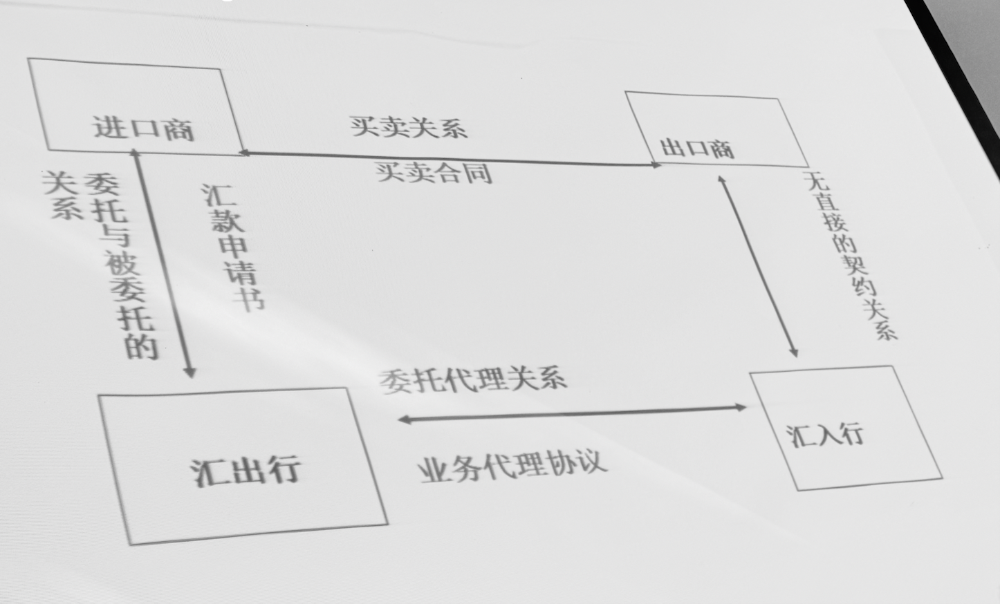
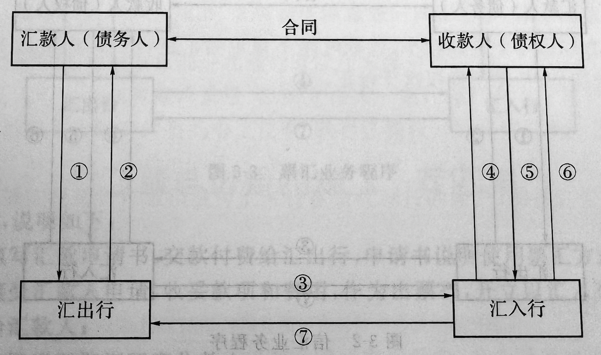
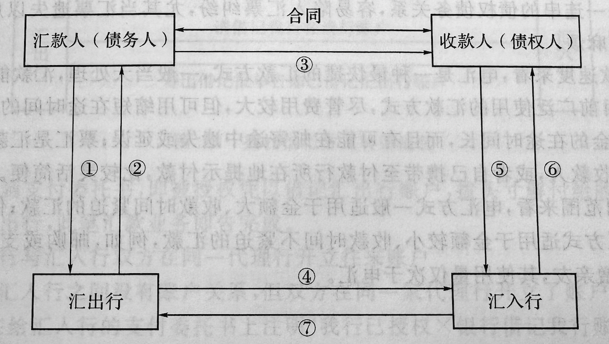

# 汇款结算方式

---

### 第一节 国际结算方式概述

#### 一、国际结算方式的含义

*一种债务人对债权人偿还债务的方式*

#### 二、国际结算方式的分类

##### 按资金流向和结算工具传送方向是否相同

- 顺汇（*Remittance*）
  
  *又称汇付法，债务人或付款人**主动**将款项交给本国银行，委托该银行使用某种结算工具，交付一定金额给国外债权人或收款人的结算方式*
  
  特点是**结算工具和流向与资金的流向相同**

- 逆汇（*Reverse Remittance*）
  
  *又称出票法，债权人以开出汇票的方式，委托本国银行向国外债权人**索取**一定金额的结算方式*
  
  特点是**结算工具和流向与资金的流向相反**

##### 按结算工具和使用方式的不同

- 传统 **\*重点**
  
  - **汇款** – *本章讲解*
  
  - 托收（*Collection*）
  
  - 信用证

- 新型
  
  - 银行保函
  
  - 国际保理
  
  - 福费廷
  
  - 备用信用证

##### 按结算方式所依据的信用基础的不同

- 商业信用为基础的结算方式
  
  *银行对结算中的收付双方均不提供信用，只是接受委托，办理款项的收付*

- 以银行信用为基础的结算方式
  
  ***银行为交易提供信用保证***

---

### 第二节 汇款的概念及其当事人

#### 一、汇款的概念

债务人或付款人主动通过银行将款项汇交收款人的结算方式，也叫*汇付*

通常由买方按合同规定条件和时间**通过银行**将货款汇交卖方

#### 二、汇款的当事人

##### （一）汇款人（Remitter）

即付款人或债务人，国际贸易中通常是进口商

##### （二）汇出行（Paying Bank）

接受付款人委托，办理款项汇出业务的银行

通常是进口商所在地银行，汇款人与汇入行是**委托与被委托**关系

##### （三）汇入行（Remitting Bank）

接受汇出行委托，向收款人解付汇入款项业务的银行

通常是出口商所在地银行，同时也是汇入行的联行或代理行

##### （四）收款人（Payee or Beneficiary）

---

### 第三节 汇款的种类及其业务程序

*根据汇出行通知汇入行解付汇款所使用通信工具的不同分为三种*

#### 一、电汇（T/T）

*Telegraphic Transfer 电报、电传、SWIFT（环球银行金融电信协会）*

##### 业务流程图

> 图中未含运输公司，因为存在**预付货款**和**货到付款**两种方式

- (1) 填写汇款申请书

- (2) 电汇回执

- (3) 寄出电汇委托书

- (4) 通知取款

- (5) 取款

- (6) 解付
  
  > 解付和偿付

- (7) 收讫借记通知书
  
  > 借记和贷记

##### 特点

- 速度快 – *当天处理，交款迅速*

- 安全性高 – *银行与银行直接通信，密押核实*
  
  > *SWIFT* 系统本身需要银行作为会员才能使用

- 费用高

> 尽管价格昂贵，只因其效率最高，现今最常见的付款方式仍然是电汇

#### 二、信汇（M/T）

*Mail Transfer 邮寄、传真（后者近年来已不常见）*

##### 业务流程图

> 和电汇流程基本一致

- (1) 填写信汇申请书

- (2) 信汇回执

- (3) 寄出信汇委托书

- (4) 通知取款

- (5) 取款

- (6) 解付

- (7) 收讫借记通知书

##### 特点

- 资金转移速度较慢，汇款在途时间较长

- 安全性较差

- 银行可短期占用资金

- 信汇费用相对低廉

> 如今已极少使用，其中美国从九十年代以来已拒绝受理信汇委托书

#### 三、票汇（D/D）

*Remittance by Banker's Demand Draft 银行即期汇票*

汇出行应汇款人申请，代替汇款人开立以其分行或代理行为解付行的银行即期汇票，由汇款人自行携带出国或邮寄给国外收款人，收款人持票结款的汇款方式

##### 业务流程图

- (1) 填写票汇申请书

- (2) 票汇回执

- (3) **寄出即期汇票**

- (4) **寄出票汇通知书**

- (5) **向银行提示汇票**
  
  - 属于付款提示

- (6) 银行付款

- (7) 收讫借记通知书

> 票汇是以**商业信用**为基础的付款方式

##### 特点

- 取款灵活

- 手续简便

- 可以止付，有一定安全性

- 银行可以无偿占用资金

- 费用最低

- **汇入行没有义务通知收款人提款**，即无需通知收款人

- **资金可以转让**

> ***上述三种均是以商业信用为基础的借款方式***

---

### 第四节 汇款的偿付与退汇

#### 一、汇款的偿付

汇款业务中，汇出行将汇款金额拨入给汇入行的行为，俗称*拨头寸*

根据情况不同有以下方式

- 汇入行在汇出行开立了往来账户
  
  - 主动贷记
  
  - 寄出贷记报告单告知已贷记汇入行账户

- 汇出行在汇入行开立了往来账户
  
  - 授权借记
  
  - 汇出行在委托汇入行解付汇款

- 汇出行与汇入行双方在同一代理行开立往来账户

- 汇出行与汇入行双方在不同银行开有往来账户 – *少见*

#### 二、汇款的退汇

汇款人或专款人中的某一方在汇款解付前要求撤销该笔汇款的行为

- 若汇款已经解付，汇款人只能与收款人交涉

- 退回可能由汇款人提出，也可能由收款人提出

##### （一）收款人退汇

- 电汇/信汇：通知汇入行，汇入行联系汇出行，按其指示方式转汇汇出行，汇出行收到退回头寸后再通知汇款人前来办理退款手续

- 票汇：收款人将汇票寄给汇款人，由汇款人去出票行注销

##### （二）汇款人退汇

- 电汇/信汇：通知汇出行，由其向汇入行发出撤销通知
  
  - 尚未解付：汇入行与收款人联系，同意则由汇入行收妥后办理退汇，不同意及时通知汇出行
  
  - 已解付：汇入行回复汇出行已解付款项，请汇款人直接与收款人联系退款事宜

- 票汇
  
  - 未寄出汇票：退票
  
  - 已寄交收款人
    
    - 收款人同意：撤回
    
    - 收款人不同意：由于汇票的无因性和流通转让性，作为汇票的出票人的汇出行，为维护自身信誉，通常不接受汇款人的撤销请求

---

### 第五节 汇款方式在国际贸易中的应用

- 预付货款、货到付款

- 支付订金

- 分期付款、延期付款

- 货款尾数的结算

- 贸易从属费用
  
  - 佣金
  
  - 退款等

> *当今环境下，国际市场大多为**买方市场**，货到付款比预付货款更常见*

#### 一、预付货款

进口商先将货款的一部分或全部汇交出口商，出口商收到货款后，立即或在一定时间内发运货物

##### （一）特点

有利于出口商，不利于进口商

- 资金压力转移给进口商

- 进口商承担出口商不履行交货交单义务的风险

##### （二）适用范围

- 出口商商品是进口国市场上的**抢手货**，进口商为了高额利润迫切需要

- 出口商顾虑进口商不履行买卖合同，以预收部分货款作为**担保**，实际上作为**预付定金**
  
  > 订金在出口商毁约时应当两倍返还
  > 
  > 定金在进口商毁约时没收

- 进口商利用出口商资金紧张之机，通过预付货款的方式，**压低商品价格**

- 和进出口双方关系密切，了解双方资信状况

##### （三）进口商防范措施

通过银行与出口商达成**解付款项条件**。主要解付条件是：收款人取款时，要出具**个人书面担保或银行保函**，担保行如期履行交货，否则退还已收到的货款并附加利息；或保证提供全套货运单据等

#### 二、货到付款

出口商先发货，等进口商收到货物后，立即或在一定时间内将货款汇交出口商，也成*赊销或记账赊销方式*

##### （一）特点

有利于进口商，不利于出口商

- 资金压力转移给出口商

- 出口商承担进口商不付货款或要求降价的风险

##### （二）种类

- 售定 – *鲜活商品等时间性较强的商品*
  
  - 货物售妥发运，并在进口商收到货物后一定时间将货款汇交出口商
  
  - 多数货到付款系指售定方式

- 寄售 – *新品种、滞销或展销商品*
  
  - 出口商先将货物运至进口国，委托进口国的商人在当地市场代为销售，待售出后被委托人将货款按规定扣除佣金后全部汇交出口商
  
  - 属于委托代售，货物价格及最终收回货款的时间都无法确定
    
    - 价格：向寄售人实时询问或确定价格区间
    
    - 货物到期后若不续约，剩余货物的处理仍由寄售人决定
  
  - 出口商承担巨大风险
  
  - 代销人仅赚取佣金，无货物所有权，所担风险极低
  
  > 作为一种**国际贸易方式**
  > 
  > - 寄售、包销
  > 
  > - 国际招投标、国际拍卖
  > 
  > - 期货交易等

##### （三）适用范围

- 长年供应的**鲜活商品**

- 适应**空运货物**到货迅速的特点

- 适应**寄售**业务的商品，*先出后结*

---

### 第六节 汇款方式的特点

- 以商业信用为基础

- 风险大
  
  - 往往无相关单据的传递
  
  - 货物一旦出口，出口方对货物的控制权基本丧失

- 资金负担不平衡

- 手续简便，费用少

> *如今最常见的汇款方式是 T/T*
