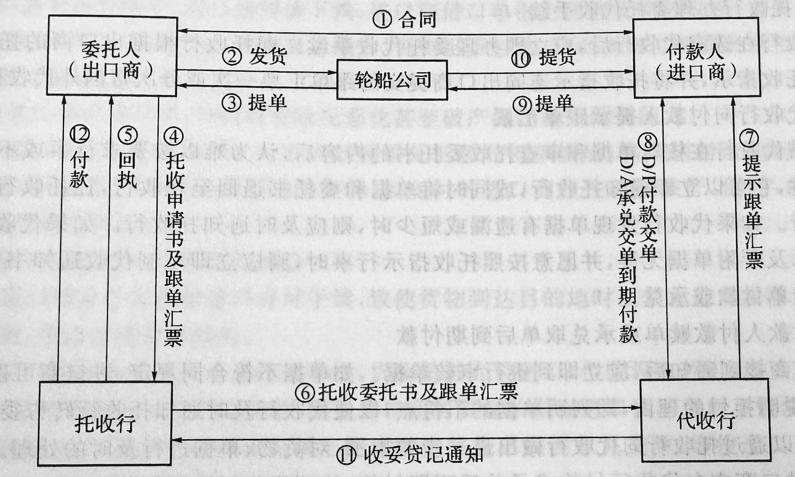

# 托收结算方式

> ~~*好乱，好繁琐，好麻烦*~~

---

### 第一节 托收的概念和当事人

#### 一、概念

见附录 p343-345

#### 二、托收的当事人

##### 基本当事人

- 委托人（*Principal*）或客户（*Consignor*）

- 托收行（*Remitting Bank*）

- 代收行（*Collection Bank*）

- 付款人（*Drawee*）

##### 其他当事人

- 提示行（*Presenting Bank*）

- 需要时的代理（*Customer Representative In Case of Need*）

---

### 第二节 托收方式的当事人的责任

> *结合流程图*

##### （一）委托人

###### -> 付款人

###### -> 托收行

- 填写托收申请书

- 签发汇票（如有）

- 交付单据

- 承担相应费用

- 及时指示货物如何处理

- 承担过失责任

##### （二）托收行

###### -> 委托人

- 核对托收申请书

- 核对单据种类与份数
  
  - 对内容完整正确与否免责

- 根据托收申请书缮制托收指示，确保内容一致
  
  > *原则上代收行由托收人指定，但在征求委托人同意后也可以更换*

- 及时通知

- 审慎职责：谨慎履行自身责任义务

- 承担过失责任

##### （三）代收行

##### （四）付款人

---

### 第三节 托收的种类

> ###### 商业单据
> 
> 发票、提单、保险单、原产地证、装箱单等，大多与货物相关
> 
> ###### 金融单据
> 
> 汇票、本票、支票

#### 一、光票托收

只有**金融单据**，往往涉及金额较小 – *如尾款*

其使用流程和汇票的使用类似，仅受票据法约束

#### 二、跟单托收

> *应用更为广泛*

必须有**商业单据**，有时也有金融单据但不必要

受票据法和合同法双重约束

##### （一）付款交单（D/P）

###### 1. 即期付款交单

###### 2. 远期付款交单

##### （二）承兑交单（D/A）

仅限于远期汇票

---

### 第四节 跟单托收的交单方式与业务程序

- (0) 托收的前提：进出口双方存在资金流动形成买卖关系

- (1) 订立买卖合同，明确规定托收方式支付货款

- (2) 货物装船

- (3) 签发提单

- (4) 有时有些国家的进出口商为**规避印花税**而不使用汇票

- (5) 回执

- (6) 寄出托收指示，和托收申请书内容一致

- (7) 即提示付款

- (7.5) **付款人付款是交单的前提条件**

- (8) 交单

- (9) 出示提单
  
  - 海运提单或空运单

- (10) 提货

- (11) 收讫贷记通知书

- (12) 款项贷记委托

---

### 第五节 托收业务的风险及其防范

---

### 第六节 托收方式的特点

---

### 第七节 《托收统一规则》简介
