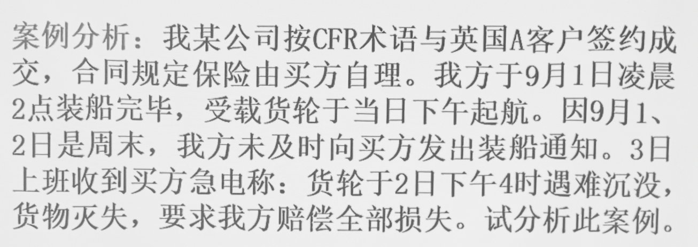
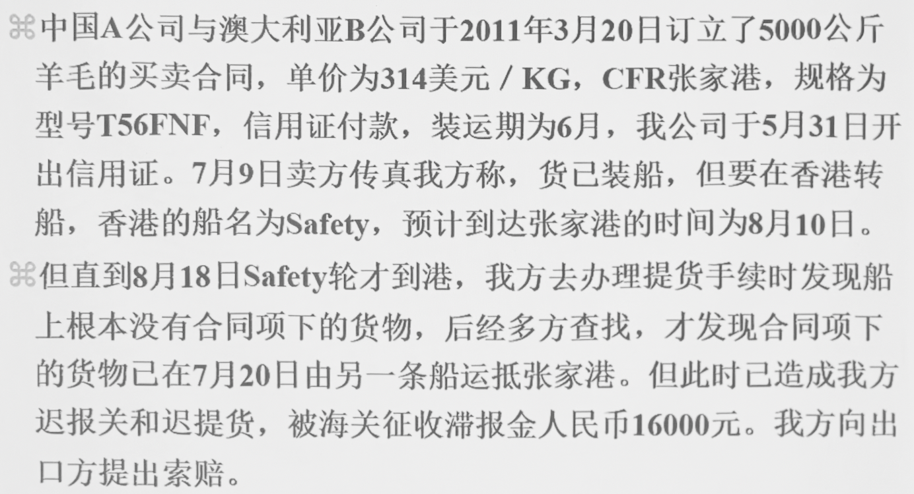
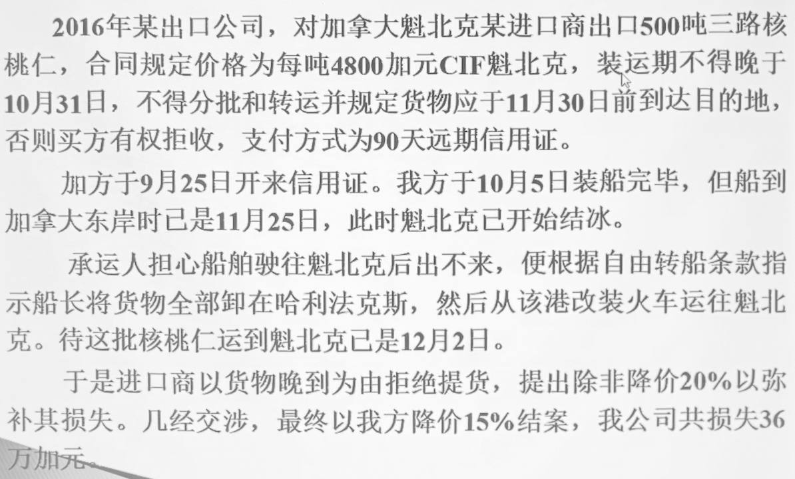
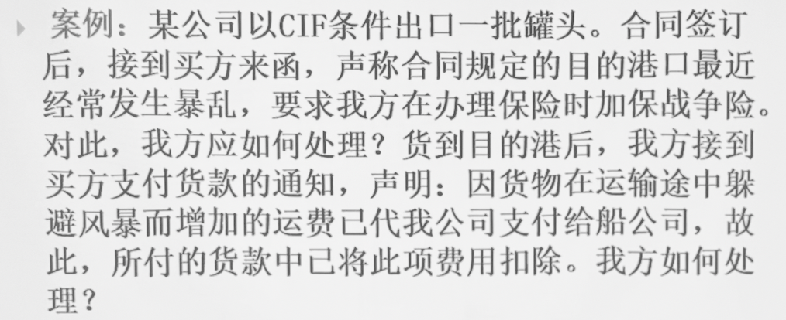
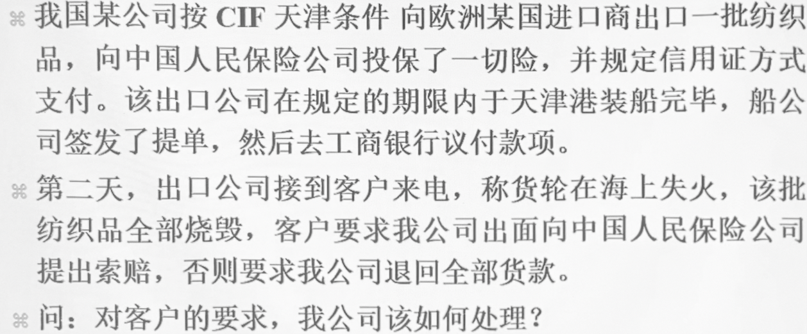
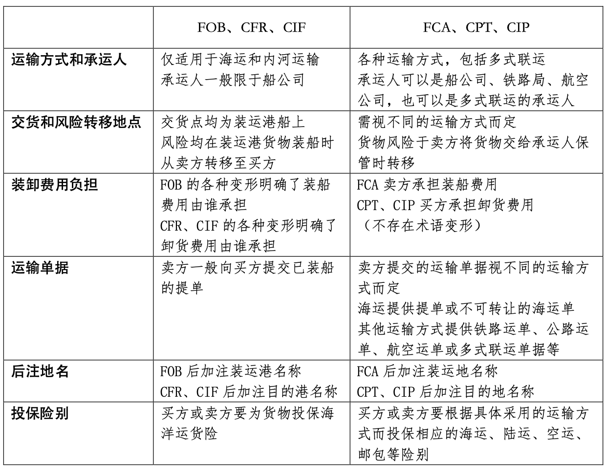

# 国际贸易术语

### 国际贸易磋商中所要解决的几个重要问题

- 何时、何地、何种方式**交接货物**

- 货物发生损坏或灭失的**风险**何时何地由卖方转移给买方

- 由谁负责办理货物的运输、保鲜和通关过境等**手续**

- 由谁承担办理上述**事项**时所需的各种**费用**

- 买卖双方需要交接哪些**单据**等

*贸易术语正是为了解决这些问题，在长期的国际贸易实践中逐渐产生和发展起来的*

---

### 第一节 国际贸易术语及国际惯例

#### 一、国际贸易术语的含义

又称**价格术语**，用以说明国际贸易中**买卖双方责任、费用和风险划分**以及**价格构成等**的专门用语的**英文字母代号**

> 一组 CIF New York 术语举例：*计价货币 USD，单位金额 500，计量单位 Per M/T*

> 从 FOB 到 CFR 再到 CIF，卖方的责任越来越大

- 表明一定的交易条件
  
  一定程度上约定了
  
  - 每一个环节由谁完成
  
  - 每一项责任由谁承担

- 表示一定的价格构成
  
  - 成交的价格与买卖双方承担的责任大小密切相关

#### 二、国际贸易术语的作用

- 简化交易手续，加速合同的订立

- 规范合同的执行，有利于解决交易纠纷

#### 三、有关贸易术语的国际贸易惯例

##### 《1932 年华沙—牛津规则》

- 专门为解释 CIF 术语制定

- 如今已经很少使用

##### 《1941 年美国对外贸易定义修订本》

- 最新为《1990 年美国对外贸易定义修订本》

- 包含六种术语 – *Ex、FOB、FAS、C&F、CIF、Ex Dock*

- 主要在美洲国家采用，其中对 **FOB** 和 **FAS** 的解释和国际商会的定义有明显差异

##### 《2000 年国际贸易术语解释通则》

- 最新为《2020 年国际贸易术语解释通则》

- 国际商会（*ICC*）创立的对各种贸易术语解释的正式规则

- 共 4 组 11 种术语
  
  - E 组 – *EXW*
  
  - F 组 – *FCA、FAS、FOB*
  
  - C 组 – *CFR、CIF、CPT、CIP*
  
  - D 组
    
    - 2000 年：*DAF、DES、DEQ、DDU、DDP*
    
    - 2010 年删去 4 个术语，添加两个术语
      
      - **DAF、DES、DDU 合并为 DAP**
      
      - **DEQ 改为 DAT**
    
    - **2020 年将 DAT 改为 DPU**
    
    最终为 *DAP、DPU、DDP*

> ***《2020 年国际贸易术语解释通则》简称《2020 通则》，本课程将要学习的正是其包含的 11 个术语***

---

### 第二节 三种主要贸易术语

> #### 一般需要包括
> 
> - 风险转移界限
> 
> - 货物的交付
> 
> - 通关手续的处理
> 
> - 主要费用的划分 – *运费和手续费往往都由办理业务的一方负责，但和保险区分*

#### 一、FOB

*Free on Board，装运港船上交货*

*FCA 是 FOB 的延伸*

##### （一）含义

- 卖方必须在合同规定的装运期内，在指定的装运港将货物交至**买方指定**的船上

- 卖方负担货物**装上船为止**的一切费用和货物灭失或损坏的风险

##### （二）买卖双方的责任和义务

###### 卖方

- 在合同规定的装运期内，在指定的装运港将货物交至买方指定的船上，并给予买方充分通知

- 办理货物出口清关

- 承担负担货物**装上船为止**的一切费用和风险

- 负责提交商业发票和证明货物已交至船上的通常单据或具有同等作用的电子信息

###### 买方

- 租船订舱、支付运费，并给予卖方关于船名、地点和要求交货时间的充分通知

- 负责办理货物进口清关以及必要时经由另一国过境运输的一切海关手续

- 承担货物在**装上船之后**的一切费用及风险

- 办理保险及支付保险费

- 接受卖方提交的与合同相符的单据，受领与合同相符的货物并支付货款

> *观察可知，在 FOB 术语下的买方责任大于卖方*

##### （三）表达式

**FOB + 指定装运港**

> US \$ 8.10 per piece **FOB Shanghai**，指按照 FOB 术语在中国上海港装船交货

##### （四）应注意的问题

###### 1. 风险划分问题

以货物**装上船**为界限

> **案例一**
> 
> 
> 
> - 关键矛盾：卖方认为损失的 2500 公吨包含买方部分，买方则认为应为剩余的 2500 公吨
> 
> - 根据《INCOTERMS2010》：**“买方承担货物灭失或损坏的一切风险以该项货物已正式划归合同项下，即清楚地划出或以其他方式确定为合同项下之货物为限”**
> 
> - 解答：
>   
>   在 FOB 术语中，**(1) 风险转移以货物特定化为前提**
>   
>   如果货物进行特定化了，证明 “该5000 吨中的 2000 吨是韩国公司的货物”，那么风险在货物装上船时转移至韩国进口商，美国出口商无需赔偿
>   
>   但在此案例中，货物抵达目的港后由承运人负责划分。由此看来，在货物运输途中，货物并没有特定化，不能证明 2500 吨损失的货物属于韩国公司的货物
>   
>   因此韩国机构有权向美国进口商要求索赔，美国公司要承担相应责任
> 
> **案例二**
> 
> 
> 
> - `1.` 成立，`2.` 不成立
> 
> - 根本原因：B 因违约而承担责任
> 
> - 解答：
>   
>   在 FOB 术语中，**(2) 违约会对风险转移产生影响**
>   
>   在本案例中，从**买方应派船而未派船时起**，风险已从卖方转移到买方

###### 2. 船货衔接问题

买卖双方均有**充分通知**义务

> 船先到货后到：造成空舱
> 
> 船后到货先到：造成额外仓储费

> **案例三**
> 
> 
> 
> - 根本原因：FOB 条件下卖方代办租船发生的问题
> 
> - 情况分析
>   
>   - 买方委托卖方办理租船订舱，卖方也可酌情接受
>   
>   - 成交货物数量不大，只需部分仓位而用班轮装运时，卖方往往按照买卖双方之间**明示或默示的协议**，代办房办理各项装运手续，包括以卖方自己的名义订舱和取得提单
>   
>   上述两种情况均属于**代办**性质，**其风险和费用仍由买方承担，运费和手续费由买方支付**
>   
>   代办情况下如果卖方租不到船，**不承担责任，买方无权撤销合同或索赔**
> 
> > 即 FOB 作为决定性大前提而存在~~理应亲力亲为的事交给别人，出了问题自然仍然追究你的责任~~

###### 3. 装船费用的负担

装船费用分为理舱费、平舱费、捆扎费、加固费等

一般情况下，**卖方要承担装船的主要费用，但不包括货物装上船后的理舱费和平舱费**，即各种装上船后产生整理等相关的费用除外

FOB 中对此类费用并没有规定，需要双方商议决定或采用**术语变形**

- **FOB Liner Terms** – *按照**班轮做法**，买方负担装船费用*

- **FOB Stowed** – *卖方负担**理舱费在内**的装船费用*

- **FOB Trimmed** – *卖方负担**平舱费在内**的装船费用*

- **FOBST** – 卖方承担**理舱费和平舱费在内**的各项装船费用

> FOB 卖方几乎没有承担任何费用

#### 二、CFR

*Cost and Freight，成本加运费*

*CPT 是 CFR 的延伸*

##### （一）含义

- 卖方按合同在指定装运港将货物交至运往**指定目的港**的船上

- 承担货物装上船前的一切货物灭失或损坏的风险以及由于各种事件造成的任何额外费用

- **负责租船订舱、支付从装运港到目的港的正常运费**

##### （二）买卖双方的责任和义务

###### 卖方

- 在合同规定的装运期内，在指定的装运港将货物交至买方指定的船上，并给予买方充分通知

- **租船订舱、支付运费**

- 办理货物出口清关

- 承担负担货物**装上船为止**的一切费用和风险

- 负责提交商业发票和证明货物已交至船上的通常单据或具有同等作用的电子信息

###### 买方

- 负责办理货物进口清关以及必要时经由另一国过境运输的一切海关手续

- 承担货物在**装上船之后**的一切费用及风险

- 办理保险及支付保险费

- 接受卖方提交的与合同相符的单据，受领与合同相符的货物并支付货款

##### （三）表达式

**CFR + 目的港**

> US $ 8.10 per piece **CFR San.Francisco**

##### （四）应注意的问题

###### 1. 风险划分问题 – *同 FOB，略*

###### 2. 租船订舱问题

- 租船：货物较多的情况

- 订舱：货物较少的情况，仅租赁部分仓位即可完成装货和运输

> **CFR** 术语要求卖方负责安排运输，卖方需要安排**通常的船只和惯常的行驶航线**来尽到责任
> 
> > 避免卖方因**无需承担船上责任**而造成的租船**不积极问题**：为节省运费成本不择手段

###### 3. 船货衔接问题

买卖双方均有**及时充分通知**义务

> **案例一**
> 
> 
> 
> - 分析：
>   
>   在 CFR 术语中，**(1) 卖方应当及时向买方发出装船通知**，以便买方及时办妥运输保险
>   
>   **否则，卖方承担的风险将延伸到运输途中**

> **案例二**
> 
> 
> 
> - 分析：
>   
>   在 CFR 术语中，**(2) 买卖双方发出的通知应当准确可靠**
>   
>   > *由信息不真实性导致的损失，责任由发出错误信息的一方承担*

###### 4. 卸货费用的负担

同样可以采用**术语变形**

- **CFR Liner Terms** – *按照**班轮做法**，卖方或船方负担卸货费用，包括驳船费和码头费*

- **CFR Landed** – *CFR **卸至码头**，卖方负担货物卸到码头上的各项有关费用*

- **CFR Ex-Ship's Hold** – *CFR **舱底交接**，买方负担货物到达目的港后，自船舱起吊直至卸至码头的卸货费用*

> CFR 卖方比起 FOB 更多承担了**运输费用**

#### 三、CIF

*Cost Insurance and Freight，成本加保险费和运费*

*CIP 是 CIF 的延伸*

##### （一）含义

- 卖方按合同在指定装运港将货物交至运往**指定目的港**的船上

- 承担货物装上船前的一切货物灭失或损坏的风险以及由于各种事件造成的任何额外费用

- **负责办理货运保险、支付保险费**

- **负责租船订舱、支付从装运港到目的港的正常运费**

##### （二）买卖双方的责任和义务

*略，补充卖方办理保险及保险费用即可*

##### （三）表达式

**CIF + 目的港**

##### （四）应注意的问题

###### 1. CIF 术语属于装运合同

> 事实上，**F 组和 C 组术语**均属于装运合同
> 
> **D 组术语**属于到达合同

根本特点：*“管装不管到“*，即上船之后的风险均由买方承担

> **卖方只需保证按时交货，无须保证按时到货**

> **案例一**
> 
> 
> 
> - 附加条件使 CIF 合同变性为**到达合同**，已经不再是真正的 CIF 合同

###### 2. 保险的有关规定

> *同样是为了规避卖方不积极问题*

- **保险公司**：信誉良好

- **保险险别**：无相反明确协议时，只需按照《协会货物保险条款》或其他类别保险条款中**最低责任的保险险别**投保

- **保险金额**：应包括合同规定的价款**另加 10%**，在我国也叫*另加一成*

- **保险货币**：保险时应以**合同货币**投保

> CIF 术语下，卖方为买方办理保险属于**代办**性质，通过保单的转让使买方获得直接向保险人索赔的权利 – *和其他保险不同，无需征得保险公司同意*
> 
> 即最终应由买方携单据索赔

> **案例二**
> 
> 
> 
> - 解答
>   
>   问题一：卖方没有责任加保 CIF 要求以外的战争险，但可以在买方自担费用的情况下替为办理
>   
>   问题二：在 CIF 术语下，**卖方所承担运费的仅限于正常运费**，风暴等意外事件造成的额外费用仍由买方负责

> **案例三**
> 
> 
> 
> - 情理上可以**帮助**，但根据 CIF 术语并**没有相应义务**

###### 3. 租船订舱问题 – *同 CFR，略*

###### 4. 象征性交货

> *同样为共有特点*

实际交货：规定时间地点，将合同规定的**货物**提交给买方或指定人

象征性交货：规定地点完成装运，**向买方提供符合合同约定的单据就完成了按时交货**，而无须保证按时到货

> *"单据买卖"*：**卖方凭单交货，买方凭单付款**

###### 5. 卸货费用的负担

*同理*

- **CIF Liner Terms**

- **CIF Landed**

- **CIF Ex Tackle**

- **CIF Ex-Ship's Hold**

> CIF 卖方比起 FOB 更多承担了**运输费用和保险费用**

#### 四、FOB、CFR、CIF 的异同

##### （一）相同

- 交货都在出口国的货运港

- 风险划分都以货物装上船为界

- 凭合格单据证明已完成交货（象征性交货）

- 卖方办理出口清关手续

- **只适用于水上运输**

##### （二）不同

|         | 手续            | 费用            |
| ------- | ------------- | ------------- |
| **FOB** | 买方负责订舱和保险     | 买方负责运费和保费     |
| **CFR** | 卖方负责订舱，买方负责保险 | 卖方负责运费，买方负责保费 |
| **CIF** | 卖方负责订舱和保险     | 卖方负责运费和保费     |

#### 五、延伸的其他三种贸易术语

> ##### 三大术语的局限性
> 
> *p87，实务案例及分析*
> 
> - 交货义务的分离使风险转移严重滞后于货物实际控制权的转移
>   
>   - 卖方从货物装车一已经丧失控制权，但风险只有装上船才能转移
>   
>   - 承运方对卖方货物运输时的质量控制**力不从心**
> 
> - 内陆地区使用 CIF 术语还有一笔额外的运输成本

而以下三种术语均把风险划分从**货物装上船**改为**货物交给承运人控制**，分别作为 **FOB、CFR、CIF** 的延伸

##### （一）FCA

*Free Carrier ( ...named place)，货交承运人...指定地点*

> **FCA + 起运地**

> ###### 注意事项
> 
> - **承运人**：可以是拥有交通工具的实际承运人，也可以是运输代理人或其他人
> 
> - **交货地点**
>   
>   - 如果是卖方所在地，当卖方将货物装上由买方指定的运输工具后，即完成交货义务
>   
>   - 如果不在卖方所在地而是其他任何地点，则当货物**在卖方的运输工具上**，**尚未卸货**而交给买方指定的承运人时，卖方即完成交货义务
> 
> - **风险转移**：以货交承运人为界

> ###### 与 FOB 的不同
> 
> - 运输方式 – *适用于多种运输方式*
> 
> - 具体交货地点和风险转移界限
> 
> - 运输单据
> 
> *缩小了卖方的风险责任范围，责任、费用划分更佳明确*

*其余项参考 FOB 即可*

##### （二）CPT

*Carriage Paid to ( ...named place of destination)，运费付至...指定目的地*

> **CPT + 目的地**

*其余项参考 CFR 和 FCA 即可*

##### （三）CIP

*Carriage and Insurance Paid to ( ...named place of destination)，运费、保险费付至...指定目的地*

> **CIP + 目的地**

> ###### 注意事项
> 
> - **保险问题**
>   
>   如果双方未在合同中规定应投保的险别，卖方要办理投保**最高的险别**，金额一般是发票金额的基础上加 10%
>   
>   > *曾经也是和 CIF 一样的最低险别，但最新通则已经修改为最高*

*其余项参考 CIF 和 FCA 即可*

##### （四）FCA、CPT、CIP 的异同

###### 相同

- 均适用于多种运输方式，包括多式联运

- 风险划分均以**货交承运人**（第一承运人）为界

- 象征性交货

- 卖方办理出口清关手续

###### 不同

*和 FOB、CFR、CIF 的不同保持一致*

|         | 手续            | 费用            |
| ------- | ------------- | ------------- |
| **FCA** | 买方负责订舱和保险     | 买方负责运费和保费     |
| **CPT** | 卖方负责订舱，买方负责保险 | 卖方负责运费，买方负责保费 |
| **CIP** | 卖方负责订舱和保险     | 卖方负责运费和保费     |

> #### 三大贸易术语与其三种延伸的区别
> 
> 
