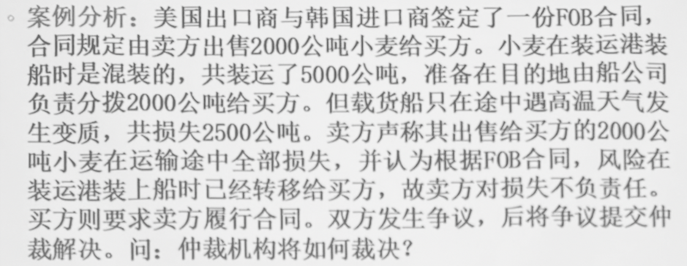
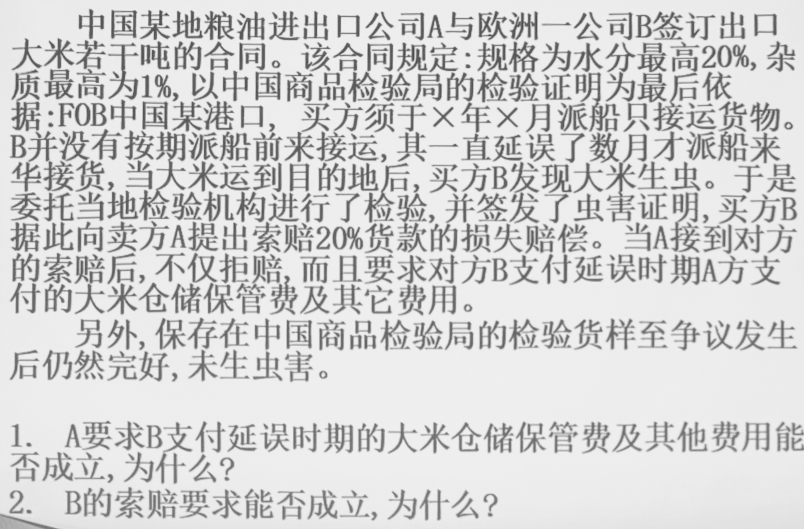
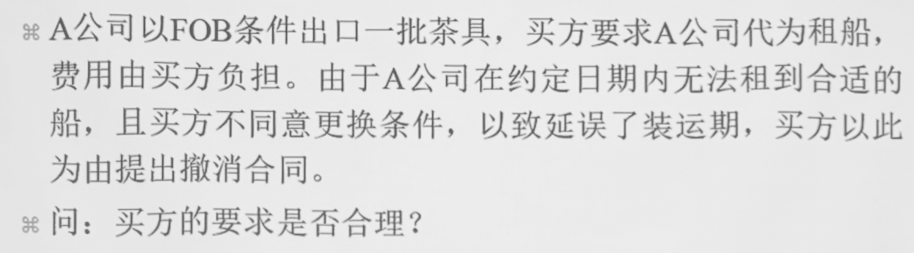

# 国际贸易术语

### 国际贸易磋商中所要解决的几个重要问题

- 何时、何地、何种方式**交接货物**

- 货物发生损坏或灭失的**风险**何时何地由卖方转移给买方

- 由谁负责办理货物的运输、保鲜和通关过境等**手续**

- 由谁承担办理上述**事项**时所需的各种**费用**

- 买卖双方需要交接哪些**单据**等

*贸易术语正是为了解决这些问题，在长期的国际贸易实践中逐渐产生和发展起来的*

---

### 第一节 国际贸易术语及国际惯例

#### 一、国际贸易术语的含义

又称**价格术语**，用以说明国际贸易中**买卖双方责任、费用和风险划分**以及**价格构成等**的专门用语的**英文字母代号**

> 一组 CIF New York 术语举例：*计价货币 USD，单位金额 500，计量单位 Per M/T*

> 从 FOB 到 CFR 再到 CIF，卖方的责任越来越大

- 表明一定的交易条件
  
  一定程度上约定了
  
  - 每一个环节由谁完成
  
  - 每一项责任由谁承担

- 表示一定的价格构成
  
  - 成交的价格与买卖双方承担的责任大小密切相关

#### 二、国际贸易术语的作用

- 简化交易手续，加速合同的订立

- 规范合同的执行，有利于解决交易纠纷

#### 三、有关贸易术语的国际贸易惯例

##### 《1932 年华沙—牛津规则》

- 专门为解释 CIF 术语制定

- 如今已经很少使用

##### 《1941 年美国对外贸易定义修订本》

- 最新为《1990 年美国对外贸易定义修订本》

- 包含六种术语 – *Ex、FOB、FAS、C&F、CIF、Ex Dock*

- 主要在美洲国家采用，其中对 **FOB** 和 **FAS** 的解释和国际商会的定义有明显差异

##### 《2000 年国际贸易术语解释通则》

- 最新为《2020 年国际贸易术语解释通则》

- 国际商会（*ICC*）创立的对各种贸易术语解释的正式规则

- 共 4 组 11 种术语
  
  - E 组 – *EXW*
  
  - F 组 – *FCA、FAS、FOB*
  
  - C 组 – *CFR、CIF、CPT、CIP*
  
  - D 组
    
    - 2000 年：*DAF、DES、DEQ、DDU、DDP*
    
    - 2010 年删去 4 个术语，添加两个术语
      
      - **DAF、DES、DDU 合并为 DAP**
      
      - **DEQ 改为 DAT**
    
    - **2020 年将 DAT 改为 DPU**
    
    最终为 *DAP、DPU、DDP*

> ***《2020 年国际贸易术语解释通则》简称《2020 通则》，本课程将要学习的正是其包含的 11 个术语***

---

### 第二节 三种主要贸易术语

> #### 一般需要包括
> 
> - 风险转移界限
> 
> - 货物的交付
> 
> - 通关手续的处理
> 
> - 主要费用的划分

#### 一、FOB

*Free on Board，装运港船上交货*

*FCA 是 FOB 的延伸*

##### （一）含义

- 卖方必须在合同规定的装运期内，在指定的装运港将货物交至买方指定的船上

- 卖方负担货物**装上船为止**的一切费用和货物灭失或损坏的风险

##### （二）买卖双方的责任和义务

###### 卖方

- 在合同规定的装运期内，在指定的装运港将货物交至买方指定的船上，并给予买方充分通知

- 办理货物出口清关

- 承担负担货物**装上船为止**的一切费用和风险

- 负责提交商业发票和证明货物已交至船上的通常单据或具有同等作用的电子信息

###### 买方

- 租船订舱、支付运费，并给予卖方关于船名、地点和要求交货时间的充分通知

- 负责办理货物进口清关以及必要时经由另一国过境运输的一切海关手续

- 承担货物在**装上船之后**的一切费用及风险

- 办理保险及支付保险费

- 接受卖方提交的与合同相符的单据，受领与合同相符的货物并支付货款

> *观察可知，在 FOB 术语下的买方责任大于卖方*

##### （三）表达式

**FOB + 指定装运港**

> US \$ 8.10 per piece **FOB Shanghai**，指按照 FOB 术语在中国上海港装船交货

##### （四）应注意的问题

###### 1. 风险划分问题

以货物**装上船**为界限

> **案例一**
> 
> 
> 
> - 关键矛盾：卖方认为损失的 2500 公吨包含买方部分，买方则认为应为剩余的 2500 公吨
> 
> - 根据《INCOTERMS2010》：**“买方承担货物灭失或损坏的一切风险以该项货物已正式划归合同项下，即清楚地划出或以其他方式确定为合同项下之货物为限”**
> 
> - 解答：
>   
>   在 FOB 术语中，**(1) 风险转移以货物特定化为前提**
>   
>   如果货物进行特定化了，证明 “该5000 吨中的 2000 吨是韩国公司的货物”，那么风险在货物装上船时转移至韩国进口商，美国出口商无需赔偿
>   
>   但在此案例中，货物抵达目的港后由承运人负责划分。由此看来，在货物运输途中，货物并没有特定化，不能证明 2500 吨损失的货物属于韩国公司的货物
>   
>   因此韩国机构有权向美国进口商要求索赔，美国公司要承担相应责任
> 
> **案例二**
> 
> 
> 
> - `1.` 成立，`2.` 不成立
> 
> - 根本原因：B 因违约而承担责任
> 
> - 解答：
>   
>   在 FOB 术语中，**(2) 违约会对风险转移产生影响**
>   
>   在本案例中，从**买方应派船而未派船时起**，风险已从卖方转移到买方

###### 2. 船货衔接问题

买卖双方均有**充分通知**义务

> 船先到货后到：造成空舱
> 
> 船后到货先到：造成额外仓储费

> **案例三**
> 
> 
> 
> - 根本原因：FOB 条件下卖方代办租船发生的问题
> 
> - 情况分析
>   
>   - 买方委托卖方办理租船订舱，卖方也可酌情接受
>   
>   - 成交货物数量不大，只需部分仓位而用班轮装运时，卖方往往按照买卖双方之间**明示或默示的协议**，代办房办理各项装运手续，包括以卖方自己的名义订舱和取得提单
>   
>   上述两种情况均属于**代办**性质，**其风险和费用仍由买方承担，运费和手续费由买方支付**
>   
>   代办情况下如果卖方租不到船，**不承担责任，买方无权撤销合同或索赔**
> 
> > 即 FOB 作为决定性大前提而存在~~理应亲力亲为的事交给别人，出了问题自然仍然追究你的责任~~

###### 3. 装船费用的负担

装船费用分为理舱费、平舱费、捆扎费、加固费等

一般情况下，**卖方要承担装船的主要费用，但不包括货物装上船后的理舱费和平舱费**，即各种装上船后产生整理等相关的费用除外

FOB 中对此类费用并没有规定，需要双方商议决定或采用**术语变形**

> - **FOB Liner Terms** – *按照**班轮做法**，买方负担装船费用*
> 
> - **FOB Stowed** – *卖方负担**理舱费在内**的装船费用*
> 
> - **FOB Trimmed** – *卖方负担**平舱费在内**的装船费用*
> 
> - **FOBST** – 卖方承担**理舱费和平舱费在内**的各项装船费用

> FOB 卖方几乎没有承担任何费用

#### 二、CFR

*Cost and Freight，成本加运费*

*CPT 是 CFR 的延伸*

##### （一）含义

##### （二）买卖双方的责任和义务

##### （三）应注意的问题

> CFR 卖方比起 FOB 更多承担了**运输费用**

#### 三、CIF

*CIP 是 CIF 的延伸*

> CIF 卖方比起 FOB 更多承担了**运输费用和保险费用**

#### 四、FOB、CFR、CIF 的异同

##### （一）相同

- 交货都在出口国的货运港

- 风险划分都以货物装上船为界

- 凭合格单据证明已完成交货（象征性交货）

- 适用于水上运输

- 卖方办理出口清关手续

##### （二）不同

|         | 手续            | 费用            |
| ------- | ------------- | ------------- |
| **FOB** | 买方负责订舱和保险     | 买方负责运费和保费     |
| **CFR** | 卖方负责订舱，买方负责保险 | 卖方负责运费，买方负责保费 |
| **CIF** | 卖方负责订舱和保险     | 卖方负责运费和保费     |
