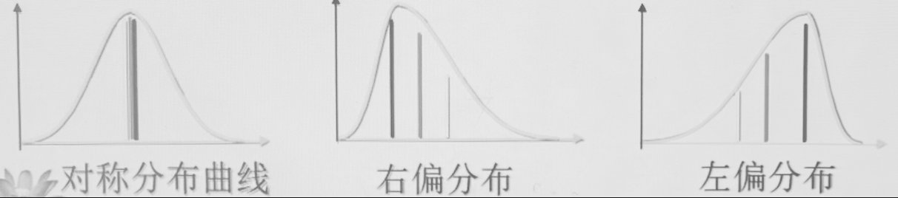

# 统计整理

---

### 第一节 统计整理概述

#### 一、统计整理的概念和作用

##### （一）概念

根据统计研究的目的对调查资料进行系统加工，使之**系统化**，成为说明总体特征的综合资料的工作过程

既包括对原始资料的整理，也包括对加工过程的综合资料，即**次级资料**的再整理

##### （二）作用

作为**中间阶段**，是统计调查的继续和统计分析的前提，起到两个**过渡作用**

- 使说明个体的材料过渡到说明总体的材料

- 使说明局部情况的材料过渡到说明全局情况的材料

#### 二、统计整理的步骤

1. **设计和编制**统计资料的汇总方案

2. 对原始资料进行**审核**
   
   - 检验资料完整性
   
   - 核验特异数据

3. 用一定的组织形式和方法，对原始资料进行**分组、汇总和计算**
   
   > 即实质性的统计整理

4. 对整理好的资料进行**再次审核**，改正各种差错

5. 编制**统计表或统计图**

6. 对统计资料妥善**保存**，系统**积累**
   
   > 原始资料大多采用表格的方式保存

#### 三、统计汇总的组织形式

##### （一）逐级汇总

按照一定的统计管理体制**自下而上逐级**进行汇总

- 优点：*可以满足各级领导机关对统计资料的需要，也便于在较小范围内发现和矫正错误*

- 缺点：*费时较长，发生差错的可能性较大*

##### （二）集中汇总（超级汇总）

越过中间环节，直接将基层的统计资料集中到统一搜集统计资料的统计机关，**一次性直接汇总**

- 优点：*缩短汇总时间，减少汇总差错*

- 缺点：*原始资料如有差错，不能就地更正，以及整理的资料有时不能满足各级领导机关的需要*

> 可见二者优缺点恰好互补，因此常常综合使用

#### 四、统计资料的审核 \*重点

##### （一）完整性审核

- 调查单位是否有遗漏

- 调查内容是否齐全

##### （二）及时性审核

- 资料是否按照规定时间报送

- 未及时报送的原因等

##### （三）准确性审核

原始资料是否正确可靠，主要用三种方法

- 对比审核 – *多种统计方法对比结果*

- 逻辑审核 – *最终结果是否合理，是否基本符合逻辑结果*

- 计算审核 – *计算方法是否正确选取*

#### （四）不正确或可疑处理

- **漏报单位或缺页缺项** – 及时催报补齐

- **可以肯定的一般性错误** – 可以代为更正，并向所属单位核对通报

- **可疑之处或无法代为更正的错误** – 通知所属单位复查更正

- **发现的错误其他单位也可能发生** – 将错误情况通报未报送资料的单位

- **严重的错误** – 返还重新填报，查明发生错误的原因。若因不正之风引起，应予以处理

- **虚报瞒报，伪造篡改统计资料** – 按《统计法》依法处理

#### 五、统计汇总技术

##### 手工汇总

采用手工操作方法，借助算盘或小型计算器进行汇总

- 常用方法有划记法、过录法、折叠法、卡片法等

##### 电子计算机汇总

---

### 第二节 统计分组

#### 一、统计分组的概念、原则和作用 \*重点

##### （一）概念

根据统计研究的目的，将统计总体按照**某种标志**划分为**若干组成部分**的一种统计方法

###### 组内同质，组间差异

*即统计分组的两方面含义*

- “分“ 总体，将总体区分为性质相异的若干部分

- “和“ 个体，将性质相同的个体组合起来

> *统计分组是统计资料整理的中心，既可表明现象之间质的差别，亦可表明现象在空间上和数量上的差别*

##### （二）原则

###### 1. 穷尽原则

同一组内各单位性质相同，不同组各单位性质相异

保证做到凡是性质相同的单位都能落在一个组内，*所有组要能一起容纳总体的全部单位*

###### 2. 互斥原则

*没有一个单位既可以放入这一组，也可以放入另一组*

表现为每组个体数量相加一定和总体数量相等

> 对于相邻两组上下限重叠的情况，原则上**上限不在内**
> 
> 如 `70~80` 组和 `60~70` 组，对于 `70` 这一变量应放在前组

##### （三）作用

- 将现象划分为不同类型

- 表明现象的内部结构

- 分析现象间的依存关系
  
  > 现象之间一般都会相互依存制约，很少有现象能完全独立于其他而存在
  
  - 正依存关系：同向
  
  - 负依存关系：反向
  
  > 同时，统计分组也是体现现象依存关系**最简单**的方法

#### 二、统计分组的方法

统计分组的关键在于**分组标志的选择**和**各组界限的划分**

##### （一）选择分组标志

**正确选择分组标志是统计分组的核心问题**，必须遵循以下原则

- 要从统计研究的**目的**出发来选择分组标志
  
  > 围绕统计研究目的，很多情况下仍然会有多个可选标志，为此

- 要选择最能反映**事物本质特征**的分组标志
  
  > ###### 研究家庭生活水平
  > 
  > 每户就业人数 – *未考虑就业质量*
  > 
  > 每个就业者负担人数 – *未考虑收入水平*
  > 
  > 家庭总收入 – *未考虑家庭规模*
  > 
  > 平均每人生活费收入 – ***最能反映本质特征***

- 要考虑事物所处的具体**历史条件和经济条件**

##### （二）划分各组界限 \*重点

在分组标志的变异范围内，划定各相邻组间的性质界限和数量界限。根据分组标志的不同，分为两大类

- 按**品质标志**分组 – *根据反映事物**属性差异**的品质标志分组，界限明确，划分容易*

- 按**数量标志**分组 – *根据反映事物**数量特征**的数量标志分组，细分为*
  
  - 单项式分组
    
    - 适用于比较集中的数据，**变量数值不多，变动范围不大**，即总体单位的不同标志值较少
    
    - 因此必须是**离散型变量**
    
    > *某年级所有学生的年龄*
  
  - 组距式分组
    
    - **变量数值较多，变动范围较大**，即总体单位的不同标志值较多
    
    - **连续型变量**只能进行组距式分组，对于**数据比较分散的离散型变量**也只能进行组距式分组
    
    > *全市收入水准、学生成绩*

#### 三、统计分组体系

##### （一）简单分组和平行分组体系

- 简单分组 – *只用一个标志对总体进行分组*

- 平行分组体系 – *对同一总体运用**两个或以上标志**进行简单分组后**平行排列**形成的体系*
  
  > *根据成绩、年龄、学号等数据整理学生数据*
  
  - 各组互不干扰，各自作为模块独立存在

##### （二）复合分组和复合分组体系

- 复合分组 – *对同一总体运用**两个或以上标志**重叠起来进行分组*

- 复合分组体系 – *由复合分组形成的体系*

> *分析高校学生构成：先按照理科文科分组，再按照本科专科、男生女生分组*

> ###### 复合分组的特点
> 
> - 可以从不同角度了解总体内部的差别和关系，因此能更全面深入了解问题
> 
> - 组数随着标志增加而成倍增加，因此标志数量要**适量**，只有在总体包括的单位数较多的情况下，才适宜采用复合分组
>   
>   > 总组数根据每一层分组组数，按照乘法法则累增

---

### 第三节 变量数列

#### 一、分配数列的概念和种类

> *分配数列即为分组工作的结果*

##### （一）概念

将总体按照一定标志分组整理，形成总体**各单位在各组间的分布**，又叫*次数分布*，由两部分组成

- **分组标志**的具体表现

- 与之相对应的**次数或频率**
  
  - 分布在各组中的总体单位数叫次数，又叫频数
  
  - 各组单位数和总体单位数之比叫频率，又叫比率或比重，一般用百分数表示

##### （二）种类

依据分组标志的不同分为两种

- **品质分配数列**
  
  是对总体按照**品质标志**分组形成的分配数列，简称*品质数列*，包含两项内容
  
  - 名称
  
  - 次数（宏观），包括次数或频率

- **变量分配数列**
  
  是对总体按照**数量标志**分组形成的分配数列，简称*变量数列*，分为两类
  
  - **单项变量数列** – *单项式分组形成*
  
  - **组距变量数列** – *组距式分组形成*

#### 二、组距变量数列的编制

> *品质分配数列和单项变量数列非常直观，无需赘述*

不仅取决于**分组标志**的选择，也要看**分组界限**的确定是否合理

##### （一）组限

即分组的**数量界限**，分为上限和下限，表示各组分组标志的最大值和最小值

- 保证每个单位都有所归属
  
  - 最低一组下限 ≦ 最小值
  
  - 最高一组上限 ≧ 最大值

- 根据研究对象的特点来确定组限
  
  - 同时利用好数据本身的特点
  
  - 也要注意约定俗成的隐含标志

- 根据分组标志的变量性质来确定组限
  
  - 对于离散型变量，采用**不连续组限**，相邻上下限往往用两个确定的不同整数表示，上下限可以不重叠
  
  - 对于连续变量，**相邻两组的组限应连续**，相邻上下限用同一个数值表示，上下限重叠，一般采用**上限不在内原则**
  
  > *实际应用中，不重叠的用法并不常见* ~~都喜欢偷懒以不变应万变是吧~~

##### （二）开口组和闭口组

###### 1. **开口组**

上限或下限不齐全的组 – *60 以下、90 以上*

###### 2. 闭口组

上下限都齐全的组 – *70～80，80～90*

> *编制变量数列时，如果有**少数极端值**存在，为避免出现空白组或个别极端值被漏掉，第一组或最后一组都可能会采取开口组的形式*

> *Fun Fact*
> 
> 有些情况，最高组是因为上限不在内原则而使用了开口组
> 
> 如成绩分组中，假设满分 100，`90~100` 的分组无法囊括 100 分，只能使用 `90 以上`

##### （三）组距

各组上下限之差

###### 1. 等距数列

各组采用相同组距，适用**标志变异比较均匀**的现象

###### 2. 异距数列

各组采用不同组距，往往因为数据自身遵循特殊自然规律，导致**标志变异不均匀**

> 如：全市所处年龄阶段人口的统计对比

##### （四）组数

分组的数目

- 分组时并非确定不变，可以适当调整

- 过多过少都不妥，一般情况下分为 5～7 组，尽可能取奇数而避免偶数

##### （五）全距

资料中**最大值和最小值的差**

对于等距数列，可以根据全距确定组距

$$
组距=全距/组数
$$

即全距一定时，组距与组数成反比

> 实践中用此方法确定组距时，可以把上下限分别向上/下取得好计算的倍数值
> 
> 如对于下限 `84`上限 `128`，可以直接看做 $组距=(130-80)/n$ （*但要注意这时该组距并非真实组距，只是作为方便确定组数的计算技巧*）

##### （六）组中值 \*重点

> *平均指标计算涉及组中值，而平均指标计算是很多统计学计算的基础*

资料中**上限和下限的中点位置**

###### 1. 闭口组的组中值

$$
组中值=(上限+下限)/2
$$

###### 2. 开口组的组中值

*核心观念：认为开口组的组距和相邻组组距相等*

- 缺上限的开口组
  
  $$
  组中值=下限+\frac{邻组组距}{2}
  $$
  
  > 如，对于 `90 以上` 和 `80~90`，前者的组中值是 $90+\frac{10}{2}$ 即 $95$

- 缺下限的开口组
  
  $$
  组中值=上限-\frac{邻组组距}{2}
  $$
  
  > 如，对于 `60 以下` 和 `60~70`，前者的组中值是 $60-\frac{10}{2}$ 即 55

> 分组时应尽可能使各组内单位值均匀分布，同时为避免过大计算误差，应尽可能使组中值为整数

##### （七）次数分配的形成过程

- 确定组数

- 确定各组组距

- 根据分组整理成次数分配表

#### 三、次数分布的主要类型

*以变量值为横轴，变量出现次数为纵轴作出曲线图*

##### （一）钟形分布

###### 特点

- 越靠近变量值中点，分布次数越多

- 越偏离变量值中点，分布次数越少

###### 分类

- 对称分布
  
  > 标准对称分布：数学中的正态分布曲线
  > 
  > 近似对称分布：全国体重数据

- 偏态分布
  
  - 右偏分布 – *往往说明存在极大值*
    
    > 我国收入水平
  
  - 左偏分布 – *往往说明存在极小值*
    
    > 健康的学生成绩分布

##### （二）U 形分布

*钟形分布水平翻折*

###### 特点

- “两头大，中间小“，又叫**浴盆曲线**

> 年龄和死亡率的关系

##### （三）J 形分布

*单调函数*

###### 特点

- “一边小，一边大“，即大部分变量值集中在某一端分布

###### 分类

- 正 J 形分布 – *单调递增*
  
  > 供给曲线

- 反 J 形分布 – *单调递减*
  
  > 需求曲线

---

### 第四节 统计表

#### 一、统计表的概念与作用

##### 概念

*将整理汇总所得到的说明总体数量特征的资料以一定的表格形式列示出来*

- 广义：统计工作各个阶段所用到的一切表格

- 狭义：表明统计整理结果的表格

##### 作用

*表现统计资料*

- 使资料**条理化、系统化**，清楚表明资料内容

- 简明易懂，一目了然，比用文字阐述**节约篇幅**

- **便于计算**各指标数值和分析各项目之间的关系

- 是**汇总和积累资料的必要手段**

#### 二、统计表的构成 \*重点

##### （一）内容上的构成

###### 1. 主词

- *整个统计总体，可能是各单位名称或各组成部分*

- 决定了统计表的长度

###### 2. 宾词

- *说明主词的各个指标，**包括指标名称和指标数值**两部分*

- 决定了统计表的宽度
  
  > 受打印限制，对于指标较多统计对象较少的情况，主词和宾词可以互换位置

##### （二）形式上的构成

###### 总标题

###### 横行标题

- *横行的名称*

- 一般位于表格的**第一列**

###### 纵栏标题

- *纵栏的标题，一般对应各项指标的名称*

- 一般写在表的右上方

###### 数字资料

- *各指标的取值，具体反映数字情况*

- 一般位于横行和纵栏的交叉处

> *横行标题对应主词，纵览标题+数字资料对应宾词*

#### 三、统计表的种类

##### （一）按作用

###### 1. 调查表

*登记调查项目的表格*

- 单一表

- 一览表

###### 2. 汇总表

*又叫**整理表**，统计整理阶段使用的表格*

是标准的统计表，用来说明总体数量特征

###### 3. 分析表

*统计分析阶段使用的表格*

##### （二）按主词是否分组以及分组程度

- 简单表 – *不分组，直接一一罗列；或者按时间顺序排列*

- 分组表 – *又叫**简单分组表**或**单一分组表**，按**一个标志**分组*

- 复合表 – *按**两个及以上**重叠标志*

#### 四、编制统计表应注意的事项

*科学、实用、简明、美观*

- 对统计资料有全面了解，合理设计排列

- 标题、表目应简明扼要说明内容，标题内或标题下注明资料所属时间、地点、单位

- 数值**精度一致**，不要求填写或不能填写的空格要填 `-`

- 栏目较多时给各栏编号
  
  - 主词：甲、乙、丙
  
  - 宾词：(1)、(2)、(3)

- 上下左右端用粗线做界限，各栏、横行和合集行之间细线

- 数值表明计量单位，单一单位可以标在表的右上方

- 必要时在表下注明资料来源，附上简明的指标解释
