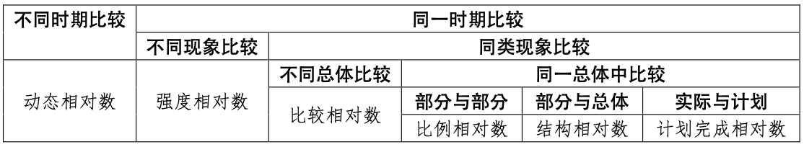

# 综合指标

*从此进入统计分析方法的学习*

## 概念

综合指标分析法：用统计指标概括和分析现象总体数量特征和数量关系的方法

综合指标：用于反映现象**总体的规模、数量对比关系和一般水平**的综合性指标

## 分类

- 总量指标 – *反映社会经济现象在一定**时间、地点、条件**下的**总**规模或**总**水平*

- 相对指标 – *用两个有联系的指标数值对比所形成的**比率**，反映社会经济现象间**数量对比**关系和**联系**程度*

- 平均指标 – *表明**同类**社会经济现象在一定**时间、地点、条件**下所达到的**一般**水平*

- 标志变异指标 – *反映总体各单位标志值的**离散**状况或**变异程度**，以平均差异形式作为平均指标的补充存在*

---

### 第一节 总量指标

#### 一、总量指标的概念和作用

##### （一）概念

又称*绝对指标*或*统计绝对数*，一般用**绝对数**表示，是最基本的统计指标

> 统计收集整理阶段能得到的指标数据只有总量指标
> 
> 因此，以外的三种指标也称作**派生指标**

> 一般情况下，*总量指标的数值和研究范围**同向**变动*，即变动研究范围一定会使总量指标数值同向跟随变化，**这也是判断总量指标的重要依据之一**
> 
> > 例外：**利润**不一定会和研究范围同向变动（存在负值）
> > 
> > > 但在单选题不作为仍然以同向变动为准~~这很现实~~

##### （二）作用

- 是认识社会经济现象的起点

- 是实行社会经济管理的依据之一

- *是计算相对指标、平均指标的基础*

#### 二、总量指标的种类

##### （一）按所反映的内容不同

- **总体单位总量** – 总体总量
  
  用来反映统计总体内包含**总体单位个数**多少的总量指标，可以表明总体的容量大小

- **总体标志总量** – 标志总量
  
  是统计总体各单位某一方面**标志值的总和**

> *对于一个确定的总体，总体单位总量只有一个，总体标志总量可以有多个*
> 
> *随着研究目的的变化，二者之间可以相互转化*
> 
> > 研究某市工业企业经营状况
> > 
> > - 总体单位总量：工业企业的数量
> > 
> > - 总体标志总量
> >   
> >   - 所有工业企业职工人数之和
> >   
> >   - 产值之和
> >   
> >   - 利润之和等等
> > 
> > 当研究目的发生变化，如改为研究某市工业企业职工素质情况
> > 
> > - 总体单位总量：所有工业企业职工人数之和

##### （二）按所反映的总体时间状况不同 \*重点

- **时期指标** – 时期数
  
  反映总体现象在**一定时间内累计总量水平**，反映社会经济现象总体在一段时间内发展过程的总结果，又称*流量指标*
  
  经济现象中常见的总量指标大多都是时期指标 – *销量、利润、产值等等*

- **时点指标** – 时点数
  
  反映总体现象在**某一时点或时刻**所达到的规模或水平，会随着时间的变化产生波动，又称*存量指标*
  
  表现为常用*期初/期末*等词修饰特指 – *月底设备数量、年初职工人数、售前产品库存*

> ###### 时期指标和时点指标的区别
> 
> - 可加性
>   
>   - 前者反映**一段时间内**，后者**某一时点**，因此只有前者具备可加性
> 
> - 指标值大小与时期关系
>   
>   - 前者**连续累计**，累计结果有实际意义，数值大小和时期长短有直接关系
>   
>   > 一般来讲同向变化，例外依然是负值导致，如**利润**
>   
>   - 后者累计结果没有实际意义，数值大小和时期长短没有直接关系
> 
> - 数据获取的方式
>   
>   - 时期指标 – *经常性调查*
>   
>   - 时点指标 – *一次性调查获得*

> 注意：死亡人口数和出生人口数这类和人口数不同，属于时期指标

##### （三）按总量指标计量单位不同

- **实物指标** – *直观具体，但不可相加，综合性差*
  
  以根据事物的**外部特征和物理属性确定的单位**计算的总量指标，又称*实物单位*，主要包括
  
  - 自然单位 – *实物本身用来计量：一个人、一棵树*
  
  - 度量衡单位 – *已经确定出的标准计量*
  
  - 复合单位 – *两个单位结合计量：人均 GDP（GDP/人数）*
  
  - 标准实物单位 – *按固定折算标准度量被研究现象数量：煤以 1 公斤 7000 公斤为标准发热量*

- **价值指标**
  
  以货币为单位计算的总量指标，又称*价值单位*，是最常见的计量单位
  
  代表一定的社会必要劳动量，具有最广泛的综合性和概括性，但比较抽象

- **劳动指标**
  
  以劳动时间为单位计算的总量指标，又称*劳动单位*
  
  把劳动者数量和劳动时间结合的产物，如*工日、工时等*
  
  > 工日 = 劳动人数 × 劳动时间
  > 
  > 如 1000 工日 = 1 人 × 1000 天 = 1000 人 × 1 天
  
  主要在企业范围内使用，尤其是产品品种较多，零件复杂多样的机械制造企业使用较多

---

### 第二节 相对指标

#### 一、相对指标概述

##### （一）概念

也称*统计相对数*，表现为发展程度、结构、强度、普遍程度或比例关系等

把**两个对比的具体数值**概括化或抽象化，使人们对事物有一个清晰的概念

##### （二）作用

- 具体表明社会经济现象之间的比例关系

- 使一些不能直接对比的事物找出共同比较的基础
  
  > 比较企业获利能力时，直接比较利润并不科学，一般比较资金利润率即 $\frac{资金}{利润}$

##### （三）表现形式

- 有名数
  
  将对比的分子指标和分母指标的计量单位结合使用，以表明事物的密度、普遍程度和强度等 – *元/人*
  
  > 六大类中，只有强度相对指标会出现有名数

- 无名数
  
  一种抽象化的数值，一般分为系数、倍数、百分数、千分数等 – *资金利润率*

> 分子数值与分母数值相差很大时，可用倍数
> 
> 成数是将对比的基数作为 10
> 
> 百分数是将对比基数作为100，是相对指标中最常用的形式，分子分母数值接近时宜用
> 
> 千分数是将对比基数作为 1000，使用于分子比分母小得多的情况

#### 二、相对指标的种类和计算方法

##### （一）计划完成程度

###### 1. 概念

是在某时期**实际完成值和计划完成值对比**的结果，一般用百分数表示

公式为

$$
计划完成程度相对数=\frac{实际完成值}{计划完成值}\times 100\%
$$

*分子项数值减去分母项数值的差额表示执行计划的绝对效果*

> 因为**正指标**和**逆指标**的存在，计划完成程度相对数大于 100% 并不一定代表超额完成
> 
> - 正指标（数值越高越好）
>   
>   - 实际大于计划 -> 大于 100% -> 超额完成
>   
>   - 实际小于计划 -> 小于 100% -> 未完成
> 
> - 逆指标（数值越低越好）
>   
>   - 实际大于计划 -> 大于 100% -> 未完成
>   
>   - 实际小于计划 -> 小于 100% -> 超额完成

###### 2. 计算

- 根据**总量指标**计算 – *直接代入公式*

- 根据**相对指标**计算
  
  有些计划任务数是以**提高率**或**降低率**表示，此时以基数 1 即 100% 来代入公式
  
  $$
  提高率计划完成程度相对数=\frac{1+实际提高率}{1+计划提高率}\times 100\%
  $$
  
  $$
  降低率计划完成程度相对数=\frac{1-实际降低率}{1-计划降低率}\times 100\%
  $$
  
  $$
  绝对效果=相对数-100\%
  $$

###### 3. 作用

- 可以准确说明各项计划指标的完成程度，为搞好经营管理提供依据

- 可以反映计划执行进度，以便及时发现问题、提出措施，推动经济建设良好发展
  
  > *以时间进度比值和计划完成程度相对数比较，可以判断计划执行超前还是滞后*~~属于常识很多人有意无意都已经在用这个方法了~~

- 可以反映计划执行过程中的薄弱环节，为组织新的平衡提供依据

##### （二）结构相对数

###### 1. 概念

在**分组**的接触上，总体区分为不同性质（即差异）的各部分，以**部分数值与总体全部数值对比**而得出的比重，来反映总体内部组成状况

公式为

$$
结构相对数=\frac{总体部分数值}{总体全部数值}\times 100\%
$$

- 一般用百分数、成数或系数来表示，**各组比重总和等于 100%**

- 其分子分母可以同是总体单位数，也可以同是总体的标志数值，*分子的数值是分母数值的一部分*

> **一般而言，分子分母不可互换**

###### 2. 作用

- 反映总体内部构成

- 根据不同时间的对比，可以反映内部发展趋势

- 反映资源利用程度及生产经营的好坏

##### （三）比例相对数

###### 1. 概念

把同一总体中某部分数值与另一部分数值静态对比，用以反映总体范围内各个局部、各个分组之间的比例关系和协调平衡状态

公式为

$$
比例相对数=\frac{总体中部分数值}{总体中另一部分数值}
$$

常用百分数来表示，也可以用比较基数单位为1、100、1000时被比较单位数是多少的形式来表示，**可以连比，但项数不能过多**

###### 2. 作用

- 反映事物内部各部分之间的数量联系程度和比例关系

- 对国民经济的宏观调控具有重要意义

##### （四）比较相对数

###### 1. 概念

又叫*类比相对数*，将不同地区（单位）之间的**同类指标数值**作静态对比得到的综合指标，表明事物在**不同空间**条件下的差异程度或相对状态

> $\frac{甲企业劳动生产率}{乙企业劳动生产率}\times100\%$

公式为

$$
比较相对数=\frac{某条件下的某类指标数值}{另一条件下的同类指标数值}\times100\%
$$

- **分子与分母指标的含义、口径、计算方法和计量单位必须保持一致**

- 一般用百分数、倍数或者系数表示

- 可以是总量指标进行对比，也可以用相对指标和平均指标进行对比

- 分子和分母可以互换位置

> 比较相对数的必须要有**可比性**才有存在意义
> 
> 如比较两企业销售收入，必须选定**生产性能相近产品**，**生产规模相当**的样本，才能计算比较相对数

###### 2. 作用

- 解释现象之间的差异程度

##### （五）强度相对数

###### 1. 概念

同一地区（单位）**两个性质不同但有联系的总量指标**数值对比得到的综合指标

> 人均GDP、人口密度、劳动生产率

公式为

$$
强度相对数=\frac{某一总量指标数值}{另一有联系而性质不同的总量指标数值}
$$

- 有两种表示方法
  
  - 一般用复名数表示，如 `元/人`，`人/平方公里`
  
  - 少数用百分数或千分数表示，如资金利润率 $\frac{利润}{投入资金}\times100\%$

- **注意：强度相对数不是平均数**
  
  > **平均数**
  > 
  > $平均工资=\frac{工资总额}{职工人数}=\frac{\sum每人的工资}{职工人数}$
  > 
  > - 分子分母必然有联系
  > 
  > - 分子是总体标志总量，分母是总体单位总量
  > 
  > - 分子分母相互对应，因此**变动一方必然引起另一方的变化**，否则结果没有意义
  > 
  > **强度相对数**
  > 
  > - 分子分母必然有联系
  > 
  > - 分子分母性质不同，**变动一方不一定引起另一方的变化**
  >   
  >   - *同样的 GDP 无论对应多少人，算出的人均 GDP 总有意义*
  >   
  >   - *同理同样的一批人，无论产生了多少 GDP，都可以计算人均 GDP*

###### 6. 正逆指标

**强度相对数的分子分母可以互换**，通过互换分子分母得到的结果根据意义的不同分为正指标和拟指标两种

举例：某地商业网点密度

- **正指标**：`零售商业机构数/人口数`，每个人拥有的零售商业机构数，**越高密度越高**

- **逆指标**：`人口数/零售商业机构数`，每个零售商业机构服务人数，**越低密度越高**

> *强度相对数的分子分母互换位置，会引起指标性质的改变*

###### 3. 作用

- 可以用来比较不同的国家、地区、部门的经济实力或为社会服务的能力

- 可以从不同角度来反映和考核企业的经济效益

- 为国家和企业编制规划和管理角色提供参考依据

##### （六）动态相对数

同一现象在**不同时期**的两个数值进行**动态**对比得出的综合指标，表明现象在时间上发展变动的程度，通常用百分数或倍数表示，也称*发展速度*

> 本节唯一一个动态分析指标

公式为

$$
动态相对数=\frac{报告期水平}{基期水平}\times100\%
$$

- 所研究的时期被称为*报告期*，也称*计算期*

- 作为对比标准的时间叫做*基期*

> $\frac{2025年利润}{2024年利润}\times100\%$

#### 三、正确运用相对指标的原则

##### （一）可比性原则

- 总体范围可比 – *以报告期总体范围为准，调整基期*

- 计算方法和计算价格可比

- 指标包含的经济内容可比

- 计算时间、计算单位等方面可比

##### （二）相对指标和总量指标结合运用的原则

- 计算分子和分母的绝对差额
  
  $增长量=报告期水平-基期水平$

- 计算每增长 1% 的绝对值
  
  $增长1\%的绝对值=\frac{增长量}{(发展速度-1)*100}=\frac{基期水平}{100}$

##### （三）多种相对指标结合运用的原则

---

### 第三节 平均指标

#### 一、概念

##### （一）概念

也称*统计平均数*，用以反映社会经济现象总体各单位某一数量标志在一定时间、地点、条件下所达到的**一般水平**

把总体各单位的标志值的**差异抽象化**，代表总体的**集中趋势**，可以用来比较同类现象在不同单位的发展状况

##### （二）分类

###### 1. 数值平均数

*指标大小和数据大小息息相关，会明显受极端值影响*

- 算术平均数

- 调和平均数

- 几何平均数

###### 2. 位置平均数

*指标大小和数据大小无关，只取决于数据在本数列中的位置，不受极端值影响*

- 众数

- 中位数

#### 二、平均指标的特点及其作用

##### （一）特点

- 只能计算同类现象

- 将数量差异抽象化

- 反映总体变量值的集中趋势

##### （二）作用

- 对比一般水平，可以反映出各地区、单位工作的质量和效果

- 对比同一现象一般水平在不同时间的变化，可以反映这类现象发展变化的趋势及其规律性

- 分析现象之间的依存关系

- 进行数量估计推断

#### 三、平均指标的计算

##### （一）算术平均数

分析社会经济现象一般水平和典型特征的最基本指标，是统计中计算平均指标**最常用**的方法，是**总体标志总量除以总体单位数**

###### 1. 简单算术平均数

*对应未分组数据*

$$
\bar X=\frac{X_1+X_2+...+X_N}{N}=\frac{\sum X}{N}
$$

###### 2. 加权算术平均数

*对应分组数据*

如果掌握的资料经分组整理编成了单项数列或组距数列，并且每组次数不同时，应采用加权算术平均数的方法计算算术平均数

$$
\bar X=\frac{X_1f_1+X_2f_2+...+X_Nf_N}{f_1+f_2+...+f_N}=\frac{\sum Xf}{\sum f}
$$

- $f_i$：权数，即标志值出现的频数（每组单位数）

- $X_if_i$：每组的标志总量

> *本质是**以次数为权数计算算术平均**，和加权平均数区分*

**特殊情况一：f 表现为比重时的公式推导**

$$
\bar X=\frac{\sum_1^N X_if_i}{\sum_1^N f_i}=\sum_1^N X_i\frac{f_i}{\sum_1^N f_i}=\sum X\frac{f}{\sum f}
$$

> *本质是**以频率为权数计算算术平均**，仍然应用同样的理论*

**特殊情况二：组距变量数列**

$X_i$ 取各组的**组中值**进行计算

如下表

| 月奖金额  | 工人人数 |
| ----- | ---- |
| 40以下  | 10   |
| 40～50 | 10   |
| 50～60 | 30   |
| 60～70 | 30   |
| 70～80 | 10   |
| 80以上  | 10   |
| 合计    | 100  |

> 前提条件：假设变量在各组中均匀分布
> 
> 因此所求结果只是近似值

$\bar X=\frac{\sum Xf}{\sum f}=\frac{35\times10+45\times10+55\times30+65\times30+75\times10+85\times10}{100}$

---

### 第四节 标志变异指标
